> Language: **English** | [简体中文](./dictionary-ui-research.md)

# Dictionary Client UI Research: Eudic / GoldenDict / MDict (Desktop + Mobile)

> Survey date 2026-10-10. Purpose: provide real client interface evidence for the unidict UI redesign.
> Criteria: **only real-device screenshots from desktop and mobile clients**; official app store screenshots and official documentation screenshots are authoritative. **Web editions never count** (the previous round was rejected for padding the survey with web editions; this round replaces every one of them with client screenshots).

## I. Survey Targets and Image Sources

| Product | Form | Screenshot source | Count |
|---|---|---|---|
| Eudic | Desktop (macOS client) | iTunes App Store official screenshots for "Eudic" on macOS (App Store page screenshots at 800x500, Apple CDN) | 6 |
| Eudic | Mobile (iOS client) | iTunes App Store official screenshots for "Eudic" on iOS (Apple CDN) | 5 |
| GoldenDict-ng | Desktop (Win/mac/Linux clients) | GoldenDict-ng official documentation site xiaoyifang.github.io/goldendict-ng/img/ (the project's official hero image and images embedded in the docs) | 5 |
| MDict | Mobile (iOS client) | iTunes App Store official screenshots for "MDict" on iOS (Apple CDN) | 5 |
| MDict | Desktop (Windows client) | Promotional image from the MDict official site mdict.cn (the only official image, **not a clean UI screenshot**, see the note below) | 1 |

> **MDict desktop note**: neither the MDict official site (mdict.cn) nor its download page **publishes clean Windows desktop UI screenshots**. There is only one promotional image (a phone-plus-book scene with a small phone interface embedded). This round labels it honestly as a promotional image and does not pass it off as a desktop UI screenshot. GoldenDict-ng is a **desktop-only project with no mobile app** - that in itself is a market conclusion, see Section IV.

Four-part criteria (applied to every screenshot): **layout / color / information density / navigation** -> adoptable / not applicable (with the reason) / which unidict screen it lands on.

---

## II. Eudic (primary reference: desktop + mobile, two forms)

### 2.1 Desktop (macOS client)

#### Figure 1 - Main lookup window
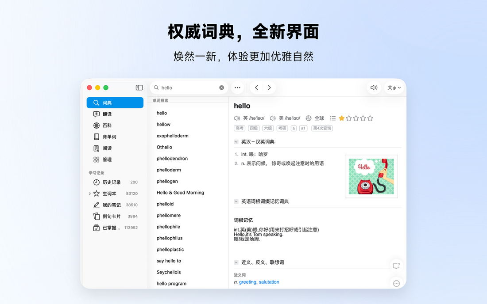
Source: App Store official screenshot for "Eudic" on macOS (original at Apple CDN, 800x500).

- **Layout**: three columns. Left = dictionary group tree (authoritative dictionaries / extended libraries, collapsible); middle = entry details (headword + phonetics + definitions + examples + collocations + related-word associations + notes, in collapsible sections); right = wordbook / learning panel. Top bar = search box + mode switch.
- **Color**: light theme, white background with light gray section separators, blue highlight on the selected item, low saturation overall and generous whitespace.
- **Information density**: high in the middle column (several collapsible sections on one screen), low in the side columns. Density is controlled by "collapsible sections" rather than by "shrinking the font size".
- **Navigation**: switch dictionaries in the left column, expand and collapse sections within the middle column, search from the top bar. Clear hierarchy, no modal interruptions.
- **Adoptable**: (1) the middle column's "headword + phonetics + multiple collapsible sections" detail organization -> lands on the unidict desktop **results page EntryResultsPane** (which already groups definitions by dictionary and could add sub-section collapsing inside each group); (2) the always-present wordbook / learning panel in the right column -> lands on the unidict desktop **sidebar wordbook tab** (currently tab-switched; a persistent preview on narrow screens could be considered); (3) the dictionary group tree in the left column -> lands on unidict **dictionary management / grouping**.
- **Not applicable**: the right column's "learning record + charts" belongs to Eudic's proprietary learning system (progress / proficiency statistics). unidict is positioned as offline lookup with no learning-progress product, so this is **not adopted** (roadmap Section A has already dropped learning statistics and achievements).

#### Figure 2 - Dictionary management (extended libraries)
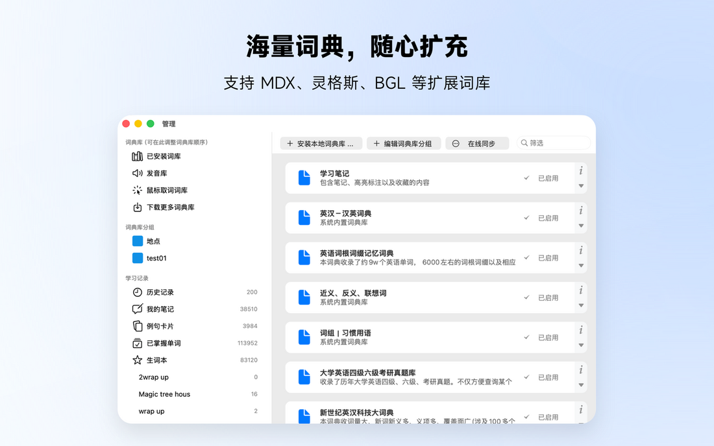
Source: same as above (App Store official screenshot for macOS).

- **Layout**: group tree in the left column + dictionary list in the right column (checkboxes to enable / disable), with a "Manage" entry at the top.
- **Color**: light theme, selected row on a pale blue background, blue check marks in the checkboxes.
- **Information density**: low, list-style, one dictionary per row.
- **Navigation**: switch groups in the left column, tick items in the right column.
- **Adoptable**: (1) lightweight "enable / disable a dictionary via checkbox" management -> lands on the unidict **settings drawer "Dictionaries" tab / gui toolbar group dropdown** (priority and grouping already exist; an enable toggle could be added); (2) the group tree staying in sync with the list -> unidict already has groups and could add a tree visualization.
- **Not applicable**: Eudic's "extended library download" is an online store. unidict is offline-first and has no online store (P-10 gated), so this is **not adopted**.

#### Figure 3 - Wordbook (table view)
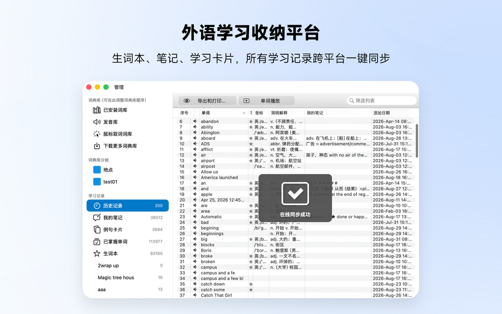
Source: same as above (App Store official screenshot for macOS).

- **Layout**: table-style wordbook with columns for word / definition / date added / proficiency, operable in-row; the screenshot shows a right-click or hover action popover (a small dark floating window).
- **Color**: light theme, light gray table header, dark hover popover (strong contrast).
- **Information density**: medium, compact but not crowded.
- **Navigation**: table sorting + filtering + in-row actions.
- **Adoptable**: (1) a multi-column table of "word + definition + date added + proficiency" -> lands on the unidict desktop **wordbook** (currently card-style; a table view toggle could be added for easier bulk browsing); (2) the in-row hover action popover -> unidict cards already carry light actions such as "+tag / note", so in-row quick actions could be added.
- **Not applicable**: the "proficiency" column belongs to the Eudic learning system and unidict has no such concept, so the column is **not adopted**.

#### Figure 4 - Word card (memorize / review)
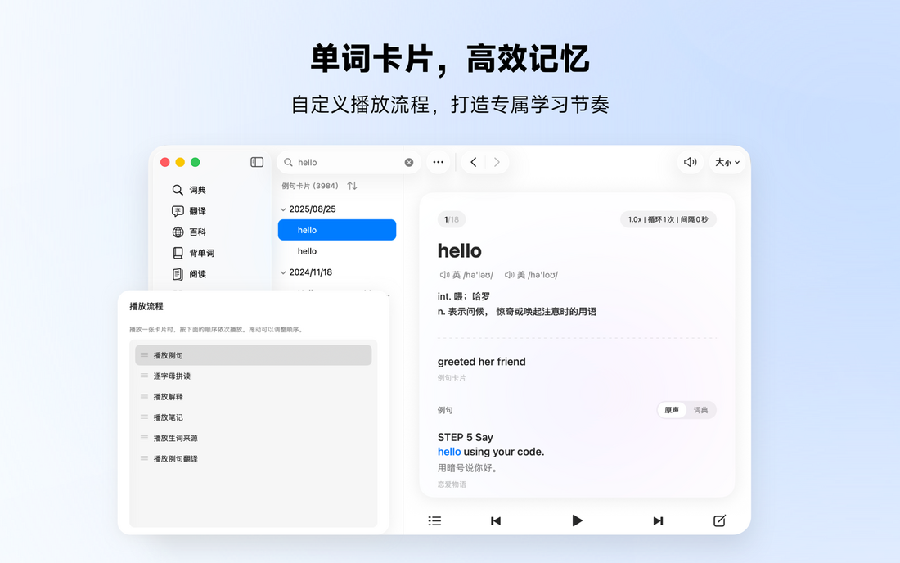
Source: same as above (App Store official screenshot for macOS).

- **Layout**: a large centered card: headword + phonetics + part of speech + definition, with three buttons at the bottom ("Know / Vague / Forgot") and a progress bar at the top.
- **Color**: light card with a blue primary button, generous whitespace, focus on a single word.
- **Information density**: very low, one word per screen.
- **Navigation**: paging driven by the three-level self-rating at the bottom.
- **Adoptable**: (1) the minimal card with a three-level "Know / Vague / Forgot" self-rating -> unidict is positioned as offline lookup and **review / spaced-repetition has already been dropped per Section A**, but if a lightweight review is ever built, these three levels are the simplest possible paradigm; (2) the large-type whitespace card aesthetic can be borrowed for the unidict **results page entry card header** (the header has already been upgraded and could further strengthen the headword's visual hierarchy).
- **Not applicable**: the whole "word memorization / review" flow conflicts with the unidict positioning (Section A), so it is **not adopted**.

#### Figure 5 - Mouse hover lookup (floating window)
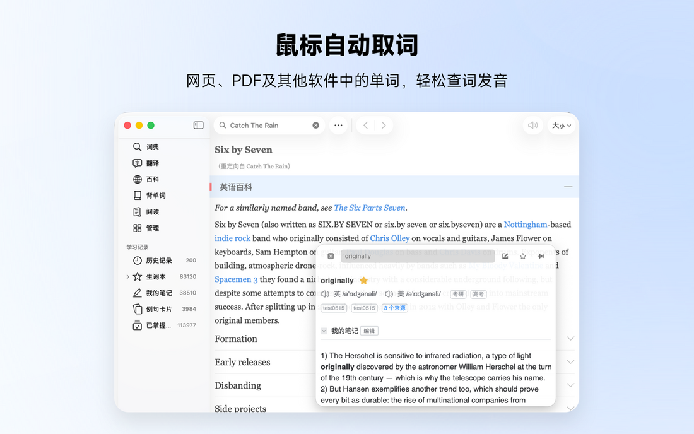
Source: same as above (App Store official screenshot for macOS).

- **Layout**: a small floating window over the document / web page: headword + phonetics + definition + pronunciation button + "Add to wordbook", translucent dark, pinned to the cursor.
- **Color**: dark translucent overlay, contrasting with the underlying document.
- **Information density**: low, only the core definition is given.
- **Navigation**: light actions inside the floating window (pronounce / favorite), collapses as soon as it loses focus.
- **Adoptable**: (1) a small window pinned to the cursor + translucent dark + core definition -> maps directly onto the unidict **hover lookup pane QuickLookupPane** (already delivered; the information hierarchy can be refined by comparison: the arrangement of headword / phonetics / definition / pronunciation / add-to-wordbook); (2) how legibility on a light document is preserved with a translucent dark surface.
- **Not applicable**: Eudic triggers lookup by "hovering the mouse automatically"; unidict uses clipboard / hotkey lookup (hovering was already dropped per Section A), so the **trigger mechanism is not adopted**; only the floating window visuals are borrowed.

#### Figure 6 - AI large-model translation

Source: same as above (App Store official screenshot for macOS).

- **Layout**: left-right split (input on the left, output on the right), style selector in the top bar, input area at the bottom.
- **Color**: light theme, the two columns separated by a light gray background.
- **Information density**: medium, two columns side by side.
- **Navigation**: switch translation style / glossary from the top bar.
- **Adoptable**: (1) the "input left, output right" two-column comparison -> unidict already has an AI external command bridge (UNIDICT_AI_CMD) and could reference the two-column layout if a visual interface is built; (2) the concept of "custom translation style / glossary" -> the unidict AI bridge could expose a "style" parameter.
- **Not applicable**: online large-model translation requires provider authentication and infrastructure (LLM integration deferred in the roadmap). unidict takes the **local external command bridge** route, so **online large models are not adopted**.

### 2.2 Mobile (iOS client)

#### Figure 1 - Lookup detail page

Source: App Store official screenshot for "Eudic" on iOS (Apple CDN).

- **Layout**: top search bar + back button; entry details = sectioned list (basic definitions / collocations / related-word associations / notes) with highlighter marks; bottom tab bar (Dictionaries / Notes / ...).
- **Color**: light theme, white background + blue links + yellow highlighter marks.
- **Information density**: medium-high, sectioned list plus highlights.
- **Navigation**: search from the top bar, tabs at the bottom, in-page section anchors.
- **Adoptable**: (1) the "Dictionaries / Notes" bottom tab switching between definitions and notes -> lands on the unidict **mobile lookup detail** (the Android shell is currently a single page and could add a Notes tab); (2) highlighter marks -> unidict notes could add highlight marking; (3) sectioned list plus anchor jumps.
- **Not applicable**: the learning entries in the multi-tab bottom bar (wordbook / review) belong to the Eudic learning system and are **not adopted**.

#### Figure 2 - Dictionary library management
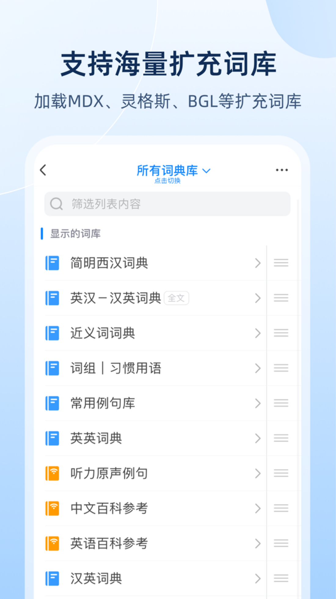
Source: same as above (App Store official screenshot for iOS).

- **Layout**: grouped list (English-Chinese / Chinese-English / idioms / set phrases / bilingual / English-English / native audio examples / encyclopedia), checkboxes on the right, "Manage" at the top.
- **Color**: light theme, group header text in gray.
- **Information density**: low, list-style.
- **Navigation**: manage entry in the top bar, ticking items in the list.
- **Adoptable**: (1) "check to enable dictionaries" on mobile -> lands on the unidict **mobile settings / dictionary management** (the current Android shell has no dictionary enable management and could add it); (2) group headers plus list.
- **Not applicable**: downloading extended libraries online -> offline-first, **not adopted**.

#### Figure 3 - Word memorization (memory card)
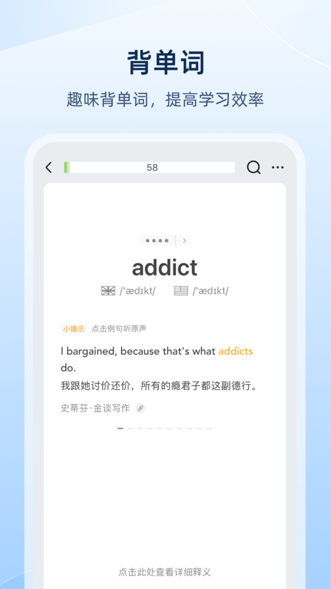
Source: same as above (App Store official screenshot for iOS).

- **Layout**: full-screen card: headword + phonetics + part of speech + definition, with "Know / Vague" buttons at the bottom and progress at the top.
- **Color**: light theme, blue buttons.
- **Information density**: very low.
- **Navigation**: paging driven by the bottom self-rating.
- **Adoptable**: the three-level self-rating card paradigm (same as desktop Figure 4).
- **Not applicable**: the review flow conflicts with Section A, so it is **not adopted**.

#### Figure 4 - Learning record + highlighter
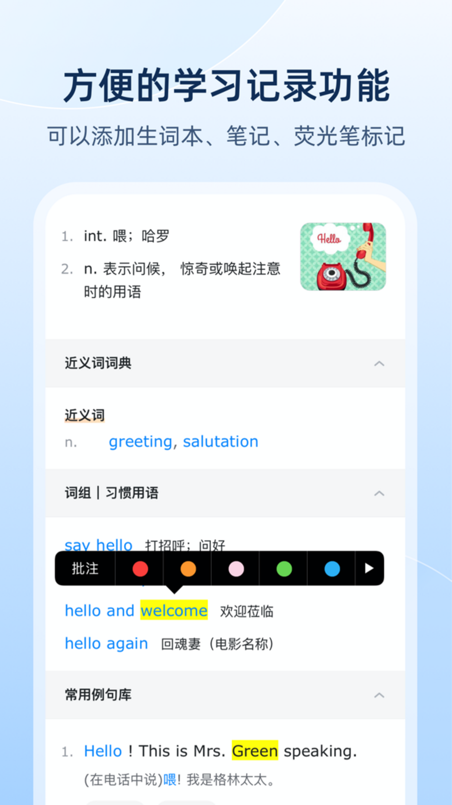
Source: same as above (App Store official screenshot for iOS).

- **Layout**: entry details plus a notes area, with highlighter marks inside notes (multiple colors: yellow / green / blue), and a bottom toolbar (pronunciation / notes / highlighter / ...).
- **Color**: light theme, multicolor highlighter marks.
- **Information density**: medium.
- **Navigation**: tool switching in the bottom bar.
- **Adoptable**: (1) multicolor highlighter marks -> unidict **notes** could add highlighting (notes are currently plain text / Markdown); (2) the bottom toolbar (pronunciation / notes / favorite) -> the bottom bar of the unidict mobile lookup page.
- **Not applicable**: "learning record / progress" statistics -> already dropped per Section A, **not adopted**.

#### Figure 5 - Pronunciation library settings
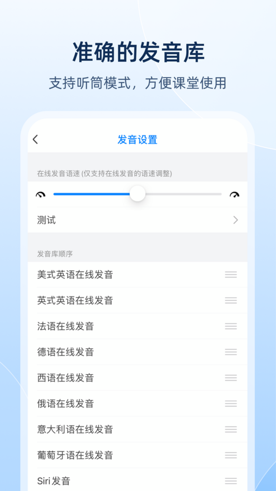
Source: same as above (App Store official screenshot for iOS).

- **Layout**: a list of pronunciation sources (American / British / French / German / Spanish / Italian / Portuguese ... online voices), each row with a toggle.
- **Color**: light theme, blue toggles.
- **Information density**: low.
- **Navigation**: list plus toggles.
- **Adoptable**: (1) a list of multi-accent / multi-language pronunciation sources with toggles -> lands on the unidict **settings "Speech" tab** (accent / volume / rate already exist; multi-language source toggles could be added); (2) the clean settings paradigm of list plus toggle.
- **Not applicable**: online pronunciation sources require a network (unidict has online pronunciation off by default and only speaks the looked-up word), so **the list interaction can be borrowed but the dependency on online sources is not adopted**.

### 2.3 Eudic Summary (adoptable takeaways)

1. **Collapsible sections on the results page** (Figure 1) -> add sub-section collapsing inside sections of the unidict desktop EntryResultsPane.
2. **Hover lookup window visuals** (Figure 5) -> refine the unidict QuickLookupPane by comparison.
3. **Wordbook table view** (Figure 3) -> add a table / card dual view to the unidict desktop wordbook.
4. **Dictionary enable checkboxes** (Figure 2) -> the unidict settings Dictionaries tab plus dictionary management on mobile.
5. **Highlighter marks in notes** (Figure 4) -> add highlighting to unidict notes.
6. **Mobile "Dictionaries / Notes" tabs** (Figure 1) -> add a notes entry to the lookup page of the unidict Android shell.
7. **Multi-accent pronunciation source list** (Figure 5) -> add accent toggles to the unidict settings Speech tab.

---

## III. GoldenDict-ng (desktop comparison: desktop-only, no mobile app)

> **Market conclusion**: GoldenDict-ng is an open-source desktop dictionary with **only a desktop client and no mobile app**. This shows that the "dictionary" category contains a set of desktop-only utility products aimed at heavy lookup and translation users. That positioning sits closer to unidict's "offline lookup" identity, which makes it a more suitable desktop reference than Eudic.

#### Figure 1 - Windows light main window
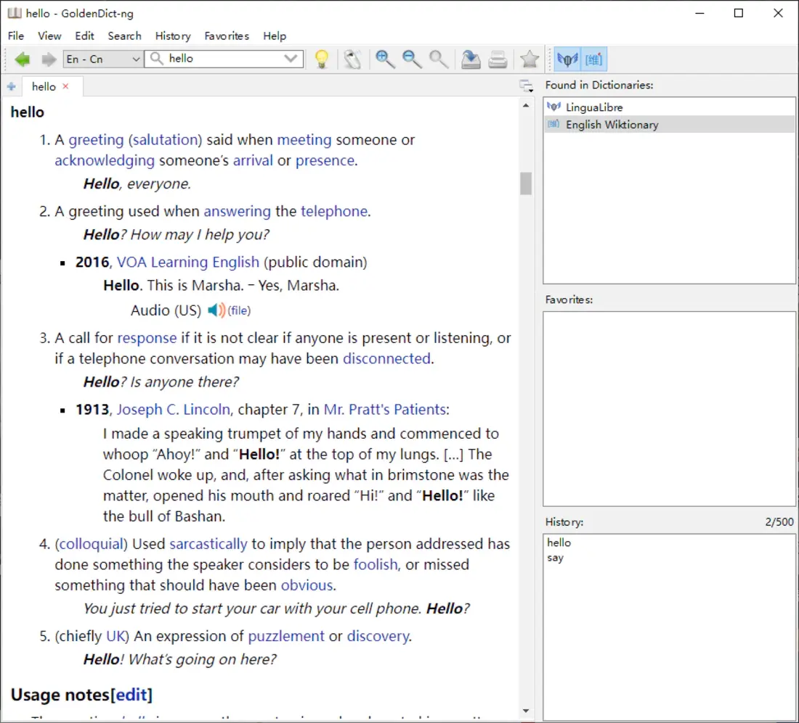
Source: GoldenDict-ng official documentation site img/gd_windows_white.webp (the project's official hero image).

- **Layout**: a classic three-column desktop layout - a top menu bar (File/View/Edit/Search/History/Favorites/Help) plus a toolbar (dictionary selection + search + icons for several lookup modes); left = entry details (numbered definitions + phonetics + pronunciation button + examples + source attribution + usage notes); right = Found in dictionaries (the list of matched dictionaries) + Favorites + History (2/500).
- **Color**: light theme, white background + black text, blue links, colored toolbar icons.
- **Information density**: high, several columns and sections per screen, achieved through column splitting rather than smaller type.
- **Navigation**: top menu plus toolbar, details in the left column, matches / favorites / history in the right column. Rather deep hierarchy (a traditional desktop application).
- **Adoptable**: (1) the "Found in dictionaries" right column **shows which dictionaries matched** -> lands on the unidict results page (which currently groups results by collapsible dictionary sections and could add a "matched dictionaries" overview chip); (2) History shows a **count** such as "2/500" -> unidict history could add a count; (3) iconifying the several lookup modes -> the unidict mode dropdown could consider icon support.
- **Not applicable**: (1) the multi-level top menu (File/Edit/View...) is a traditional desktop paradigm; unidict uses a sidebar plus drawers, which is more modern, so the **menu bar is not adopted**; (2) the always-present Favorites / History in the right column take up space permanently, whereas unidict tabs are more economical, so this is **not adopted**.

#### Figure 2 - macOS dark main window
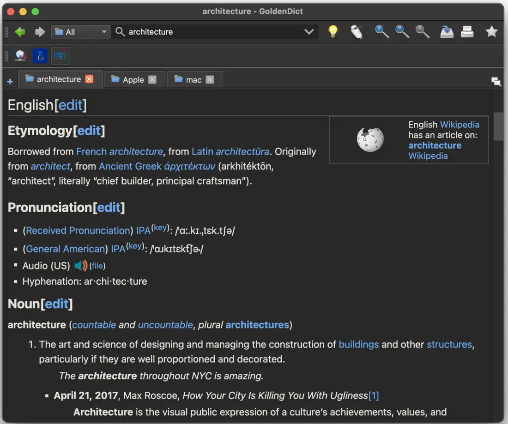
Source: GoldenDict-ng official documentation site img/gd_mac_black.webp.

- **Layout**: same structure as Figure 1 (toolbar + details on the left + matches on the right), but with a dark theme; multiple tabs (architecture/Apple/mac) switch between already-open entries.
- **Color**: dark theme, dark gray background + light text, bright blue links, high contrast overall.
- **Information density**: high.
- **Navigation**: tabs to switch entries plus the toolbar.
- **Adoptable**: (1) the **contrast handling of the dark theme** (bright blue links, light gray body text) -> unidict already follows the system light or dark setting and can use this to compare dark-mode legibility; (2) multiple tabs holding multiple entries -> the unidict results page could consider multi-entry tabs.
- **Not applicable**: unidict already supports dark mode (following the system), so nothing extra needs to be adopted.

#### Figure 3 - Linux light theme + search suggestions + Chinese dictionary
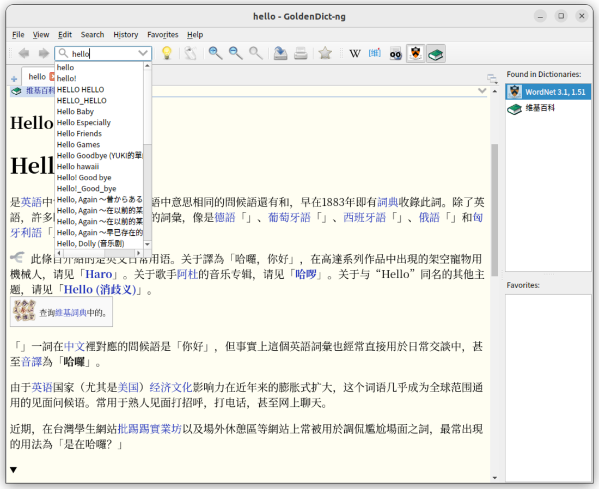
Source: GoldenDict-ng official documentation site img/gd_linux_genshin.webp.

- **Layout**: the same main window, but activating the search box pops up a **search suggestion dropdown** (`hello/Hello/HELLO/你好/hello baby/...` grouped into dictionary matches + suggestions); the right column Found in dictionaries shows WordNet/Wikipedia; the left column shows Chinese dictionary definitions (Wiktionary).
- **Color**: light theme, white dropdown background with gray group headers.
- **Information density**: high.
- **Navigation**: search suggestion dropdown plus grouping.
- **Adoptable**: (1) the **search suggestion dropdown** (suggestions appear as you type, grouped into exact matches / prefixes / suggestions) -> lands on the unidict search box (suggestions already exist and can be compared for grouping and layout); (2) the mixed Chinese-English rendering of the Chinese Wiktionary.
- **Not applicable**: none in particular.

#### Figure 4 - Dictionaries management dialog (Sources tab)
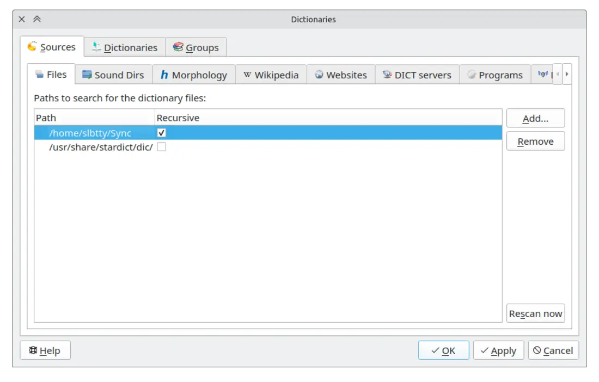
Source: image img/dict_file_tab.webp embedded in the manage_sources page of the GoldenDict-ng official documentation site.

- **Layout**: a dialog with three tabs at the top: Sources / Dictionaries / Groups; under Sources, sub-tabs for Files / SoundDirs / Morphology / Wikipedia / Websites / DICT servers / Programs; the body is a list of search paths (Path + Recursive checkboxes), with Add / Remove buttons and Rescan now.
- **Color**: light theme, table plus checkboxes.
- **Information density**: medium, many configuration items but clearly partitioned.
- **Navigation**: nested tabs (source type -> path list).
- **Adoptable**: (1) **local dictionary source management** in the form of "dictionary file search paths + recursive checkbox + Rescan" -> lands on unidict **dictionary management** (which currently uses UNIDICT_DICTS / a scanned directory and could add path visualization and rescanning); (2) the three-tab Sources / Dictionaries / Groups organization -> dictionary management in unidict can reference it.
- **Not applicable**: source types such as SoundDirs / Morphology / Websites / DICT servers / Programs exceed the format range unidict currently supports, so they are **not adopted**.

#### Figure 5 - Dictionary information panel
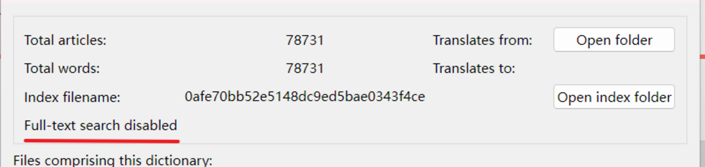
Source: image img/dictionary-info-fullindex.png embedded in the custom_dictionary page of the GoldenDict-ng official documentation site.

- **Layout**: a read-only information list - Total articles 78731 / Total words 78731 / Index filename (hash) / Full-text search disabled / Open folder / Open index folder buttons.
- **Color**: light theme, plain text plus buttons.
- **Information density**: low.
- **Navigation**: read-only display plus opening the folder.
- **Adoptable**: (1) displaying dictionary metadata such as **entry count / headword count / whether full-text search is available** -> lands on unidict dictionary management (cli-std --list-dicts-verbose already reports entry counts, and the UI could add full-text search status and index file information); (2) "Open index folder" exposing the local file location -> unidict could add "open dictionary directory".
- **Not applicable**: none.

### 3.1 GoldenDict Summary

1. The **"Found in dictionaries"** right-column match overview -> add a matched-dictionary chip to the unidict results page.
2. Grouped search suggestion dropdown -> refine unidict search box suggestions by comparison.
3. Local dictionary source path management + rescan -> add path visualization and rescanning to unidict dictionary management.
4. Dictionary metadata panel (entry count / full-text search status / index file) -> add an information display to unidict dictionary management.
5. Dark-mode contrast -> compare against unidict dark-mode legibility.
6. The traditional menu bar is **not adopted** (unidict's sidebar plus drawers are more modern).

---

## IV. MDict (mobile comparison + desktop note)

> MDict is a long-established dictionary format with multi-platform clients (iOS/Android/Windows). **The official site publishes no clean desktop UI screenshots**, so the desktop side has only one promotional image (labeled honestly). Mobile screenshots are plentiful.

### 4.1 Mobile (iOS client)

#### Figure 1 - Entry detail (butterfly, Chinese dictionary)
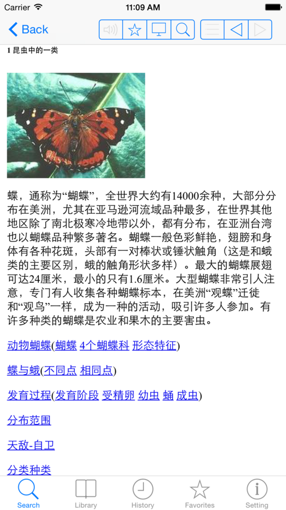
Source: App Store official screenshot for "MDict" on iOS (Apple CDN).

- **Layout**: top search + back button; entry = headword + illustration + sectioned list (basic explanation / detailed explanation / Kangxi Dictionary / Kangxi Dictionary...); bottom tabs (Dictionaries / Stroke / Radical / ...).
- **Color**: light theme, full-color illustrations, bold section headers.
- **Information density**: medium-high.
- **Navigation**: search in the top bar, tabs at the bottom, sections within the page.
- **Adoptable**: (1) **entry illustrations** (the butterfly image) -> unidict MDict .mdd resources can already render images, and the mobile side could strengthen illustration display; (2) a sectioned list with Chinese dictionary sections such as the Kangxi Dictionary.
- **Not applicable**: "Stroke / Radical" at the bottom are Chinese-specific lookups; unidict targets mainly English, so this is **not adopted**.

#### Figure 2 - High-density lookup of "person"
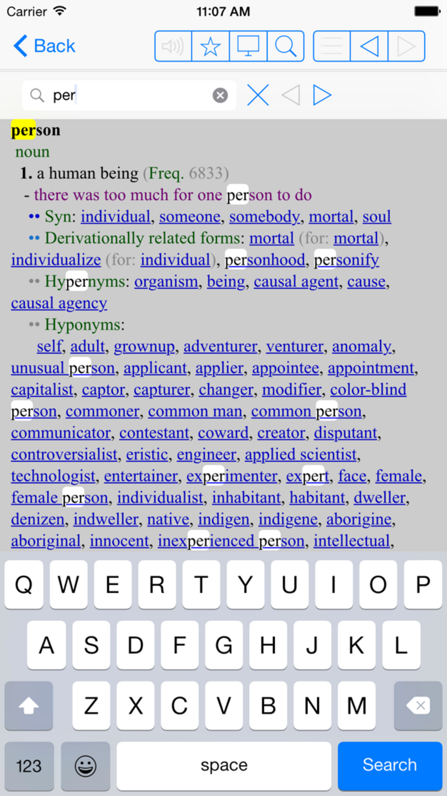
Source: same as above (App Store official screenshot for iOS).

- **Layout**: headword + phonetics + part of speech, followed by high-density sections (definitions / inflections / synonyms and antonyms / word differentiation / common phrases / usage distinctions / roots and affixes...), with the keyboard popped up at the bottom.
- **Color**: light theme, plain text, bold section headers with indentation.
- **Information density**: **extremely high**, packing many sections onto one screen, relying on heading hierarchy rather than whitespace.
- **Navigation**: in-page anchors plus the bottom keyboard.
- **Adoptable**: (1) the trade-off of **high-density multi-section** layout - MDict chooses to "pack it full" while unidict chooses to "collapse", and the two can be combined: collapsed by default, expandable to see everything; (2) sections such as inflections / roots and affixes -> the unidict Content tab already has related-word associations and collocations, and could add inflections.
- **Not applicable**: the pure pack-it-full density tends to feel cramped on a small mobile screen, so it is **not adopted wholesale**; only "sections + collapsible" is taken.

#### Figure 3 - Search suggestions
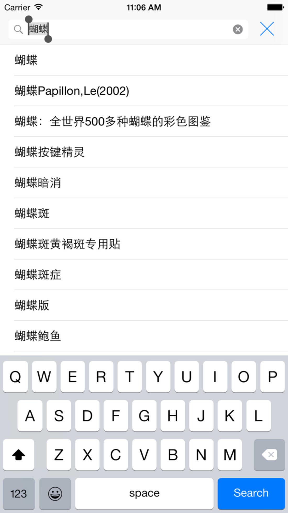
Source: same as above (App Store official screenshot for iOS).

- **Layout**: search box + suggestion list (grouped under NewGroup/WordNet3.0_v2/Vb2012/ETDict, plus entry suggestions such as butterfly / orchid / butterfly fruit...), with the keyboard at the bottom.
- **Color**: light theme, gray group headers.
- **Information density**: medium.
- **Navigation**: suggestion list plus keyboard.
- **Adoptable**: (1) **grouping** of search suggestions (dictionary group / entry) -> compare against unidict search suggestions; (2) Chinese entry suggestions (orchid / butterfly fruit).
- **Not applicable**: none.

#### Figure 4 - Dictionary management (Dicts tab)
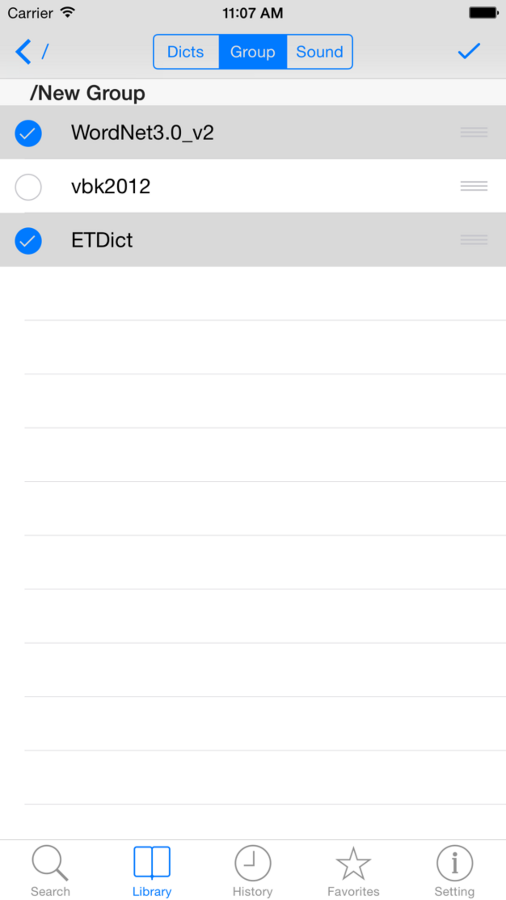
Source: same as above (App Store official screenshot for iOS).

- **Layout**: three tabs at the top: Group / Dicts / Sound; under Dicts, a dictionary list (WordNet3.0_v2/Vb2012/ETDict) plus checkboxes.
- **Color**: light theme.
- **Information density**: low.
- **Navigation**: tabs plus ticking items in the list.
- **Adoptable**: (1) **check to enable dictionaries** on mobile (same as Eudic Figure 2) -> add dictionary management to the unidict Android shell; (2) the Group / Dicts / Sound tab organization.
- **Not applicable**: unidict already has speech settings, so the Sound tab (pronunciation library) can simply be **merged in**.

#### Figure 5 - All Dictionaries (keyboard state)
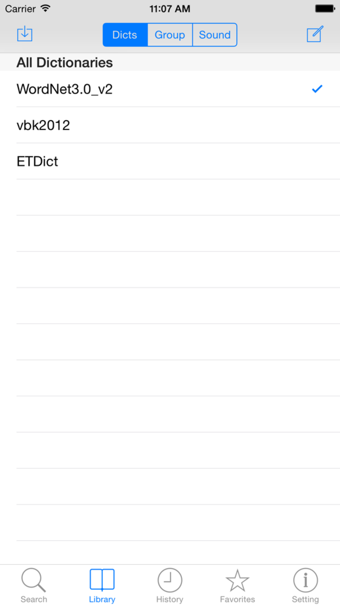
Source: same as above (App Store official screenshot for iOS).

- **Layout**: search box + dictionary list + QWERTY keyboard at the bottom, with a Search button.
- **Color**: light theme, system-gray keyboard.
- **Information density**: low.
- **Navigation**: search plus list.
- **Adoptable**: the input paradigm of search box + keyboard (the standard iOS pattern).
- **Not applicable**: none.

### 4.2 Desktop (Windows client)

#### Figure 1 - Official site promotional image (not a clean UI)
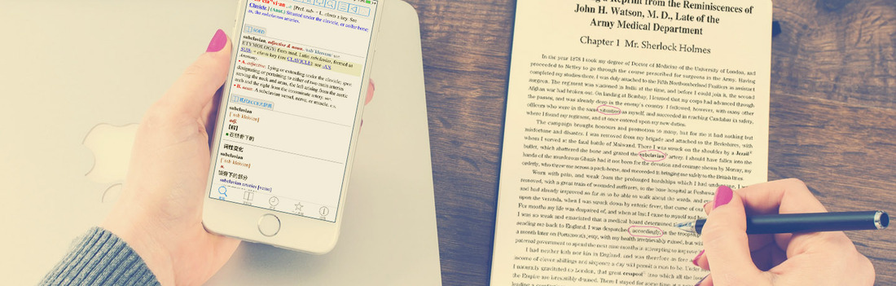
Source: MDict official site mdict.cn/wp-content/uploads/2016/07/Show.jpg.

- **Note**: this is a **promotional image** from the official site (a phone-and-book scene) with a small **phone interface** embedded (the definition of "subdeluvian" in the Chinese dictionary). It is **not a clean Windows desktop UI screenshot** - neither the MDict official site nor its download page publishes desktop UI screenshots.
- **Adoptable**: the phone interface in the image shows MDict's Chinese dictionary rendering (part of speech / definitions / examples), corroborating MDict's Chinese dictionary capability on mobile.
- **Not applicable**: a promotional image cannot serve as a basis for desktop UI, so **MDict desktop is not used as a UI reference** (it only confirms the product shape: three platforms iOS/Android/Windows plus an existing desktop client).

### 4.3 MDict Summary

1. **Entry illustrations** -> strengthen .mdd illustrations on the unidict mobile side.
2. **Grouped search suggestions** -> compare against unidict search suggestions.
3. **Check to enable dictionaries on mobile** -> add dictionary management to the unidict Android shell.
4. **Inflection sections** -> the unidict Content tab could add them.
5. **No clean desktop screenshots**, so it is not used as a UI reference (labeled honestly).

---

## V. Side-by-Side Comparison of the Three

| Dimension | Eudic | GoldenDict-ng | MDict | unidict current state |
|---|---|---|---|---|
| Form | Desktop + mobile | Desktop only | Desktop + mobile | Desktop (QML) + mobile (Android shell) |
| Desktop layout | Three columns (dictionary tree / details / learning) | Three columns (menu / details / matches + history) | No clean image on the official site | Sidebar + results panel (collapsible dictionary groups) |
| Mobile layout | Search + sectioned details + bottom tabs | - | Search + sectioned details + bottom tabs | Single-page lookup + wordbook |
| Color | Mostly light, low saturation | Light / dark dual themes | Light | Follows the system light or dark setting |
| Information density | Medium (collapsible sections) | High (many columns and sections) | Extremely high (packed full) | Medium (collapsible groups) |
| Lookup trigger | Search + hover lookup popup | Search + multiple toolbar modes | Search | Search + clipboard / hotkey + hover window |
| Dictionary management | Checkbox enable + group tree | Source paths + rescan + information panel | Checkbox enable | Priority / grouping + environment variables / scanning |
| Notes / highlighting | Highlighter marks | - | - | Plain text / Markdown |
| Learning system | Yes (word memorization / proficiency / progress) | None | None | None (dropped per Section A) |
| Online store | Yes (extended libraries) | None | None | None (P-10 gated) |

**Key conclusions**:
- **Eudic** is a "dictionary + learning" composite with the most modern and cleanest visuals, but many of its features (learning progress / word memorization / online store / AI large models) conflict with the unidict positioning, so **only the visuals and interactions are borrowed, not the features**.
- **GoldenDict** is a purely utilitarian desktop dictionary, closest to the unidict positioning; its **match overview / search suggestions / dictionary source management / metadata panel** are the most worth borrowing.
- On mobile, **MDict** offers borrowable **illustrations / grouped search suggestions / dictionary checkboxes**; its desktop side has no clean screenshots and is not used as a reference.
- The fact that **GoldenDict has no mobile app** shows that the dictionary category has a desktop-only utility layer, so the unidict desktop side can confidently be built as a "utility" rather than being forced to cover every feature.

---

## VI. unidict UI Redesign Plan (for the user's review; UI code is only touched after review)

> Principle: **borrow only visual and interaction paradigms, never features that conflict with Section A / the roadmap** (no learning progress / word memorization / online store / AI large models / mouse hover lookup).

### 6.1 Desktop (qmlui / MainDesktop.qml)

| Screen / component | Redesign action | Reference source |
|---|---|---|
| **Results page EntryResultsPane** | (1) add sub-section collapsing within sections (examples / collocations / related-word associations can be collapsed); (2) add a "matched dictionaries" chip overview at the top of the results | Eudic Figure 1 / GoldenDict Figure 1 |
| **Search box suggestions** | Group the suggestion dropdown (exact matches / prefixes / entries), refine the layout | GoldenDict Figure 3 / MDict Figure 3 |
| **Wordbook** | Add a "table / card" dual-view toggle (word + definition + date added) | Eudic Figure 3 |
| **Hover lookup pane QuickLookupPane** | Refine the information hierarchy by comparison: the arrangement of headword / phonetics / definition / pronunciation / add-to-wordbook, and legibility of the translucent dark surface | Eudic Figure 5 |
| **Settings drawer "Dictionaries" tab** | Add "enable / disable" checkboxes + dictionary metadata (entry count / full-text search status / index file) + open dictionary directory | GoldenDict Figures 4/5 |
| **Settings drawer "Speech" tab** | Add a toggle list of multi-accent / multi-language pronunciation sources | Eudic Figure 5 |
| **Dictionary management** | Add visualization of local dictionary source paths + a rescan button | GoldenDict Figure 4 |
| **History** | Add a match count (such as 2/500) | GoldenDict Figure 1 |
| **Notes** | Add highlighter marks (multicolor) | Eudic Figure 4 |
| **Dark theme** | Compare against the GoldenDict dark theme and verify link / body text contrast | GoldenDict Figure 2 |

### 6.2 Mobile (native Android shell, Compose/Kotlin)

| Screen | Redesign action | Reference source |
|---|---|---|
| **Lookup detail page** | (1) add a "Dictionaries / Notes" tab to switch between definitions and notes; (2) add highlighter marks to notes; (3) strengthen .mdd entry illustration display | Eudic mobile Figures 1/4 / MDict Figure 1 |
| **Search suggestions** | Group suggestions (dictionary / entry) | MDict Figure 3 |
| **Settings / dictionary management** | Add check-to-enable dictionaries on mobile (Group / Dicts tabs) | Eudic mobile Figure 2 / MDict Figure 4 |
| **Lookup page bottom bar** | Add a bottom toolbar (pronunciation / notes / favorite) | Eudic mobile Figure 4 |

### 6.3 Explicitly Not Adopted (to avoid tripping the Section A / roadmap red lines)

- Learning progress / proficiency / word memorization / spaced-repetition review (dropped per Section A).
- Online dictionary store / extended library download (P-10 gated, offline-first).
- Online AI large-model translation (requires provider infrastructure; unidict uses a local external command bridge).
- Automatic mouse hover lookup (dropped per Section A; unidict uses clipboard / hotkey).
- The traditional desktop menu bar (unidict's sidebar plus drawers are more modern).

### 6.4 Suggested Implementation Order (after review)

1. **Low cost, high payoff** (do these first): collapsible sections on the results page, the matched-dictionary chip, grouped search suggestions, the history count.
2. **Medium cost**: the wordbook table view, the dictionary metadata panel, note highlighting, dark-mode contrast verification.
3. **Mobile**: a Notes tab on the lookup page plus stronger illustrations, and check-to-enable dictionary management.
4. **Lookup popup**: visual comparison optimization of QuickLookupPane.

---

## Appendix - Image Source List

| File | Product / form | Source |
|---|---|---|
| assets/eudic-desktop-01..06 | Eudic macOS client | iTunes App Store official screenshots for "Eudic" on macOS (Apple CDN, 800x500) |
| assets/eudic-mobile-01..05 | Eudic iOS client | iTunes App Store official screenshots for "Eudic" on iOS (Apple CDN) |
| assets/goldendict-desktop-01..05 | GoldenDict-ng Win/mac/Linux clients | GoldenDict-ng official documentation site xiaoyifang.github.io/goldendict-ng/img/ |
| assets/mdict-mobile-01..05 | MDict iOS client | iTunes App Store official screenshots for "MDict" on iOS (Apple CDN) |
| assets/mdict-desktop-01-promo | MDict official site promotional image | mdict.cn/wp-content/uploads/2016/07/Show.jpg (**promotional image, not a clean desktop UI**) |
