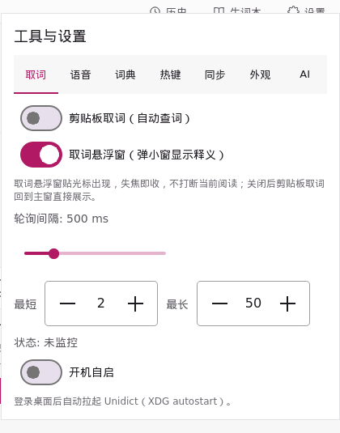
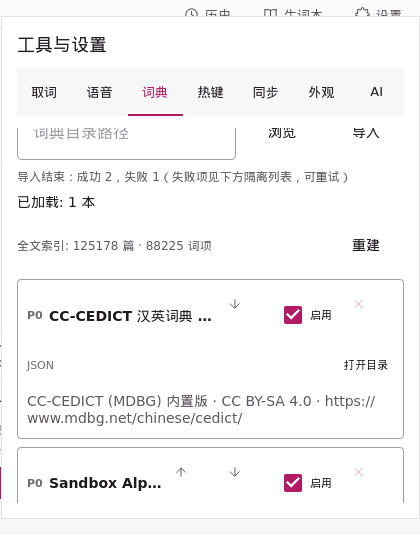
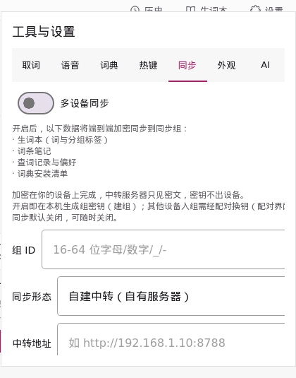
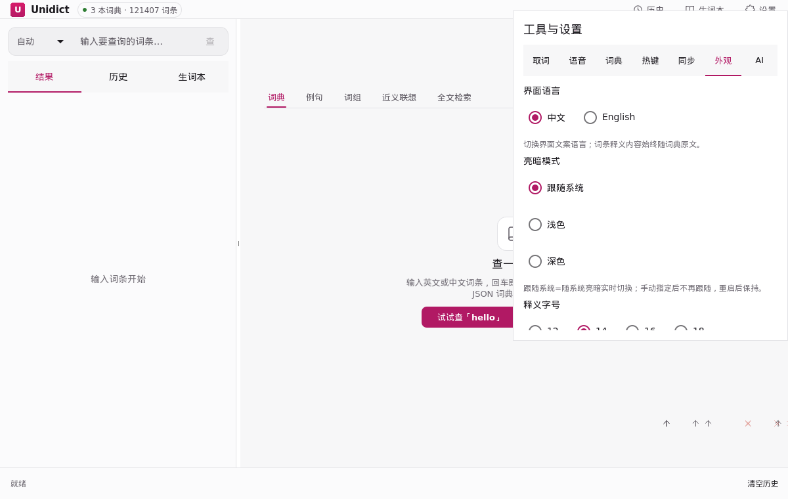
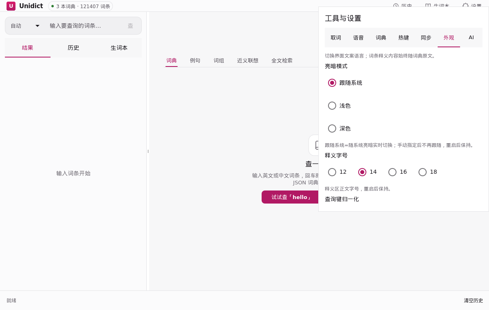
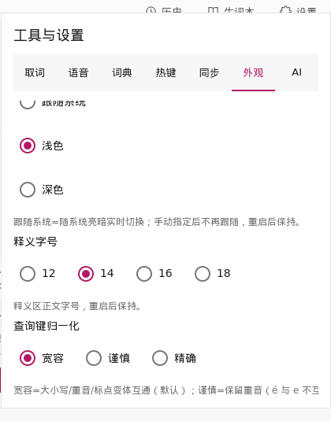
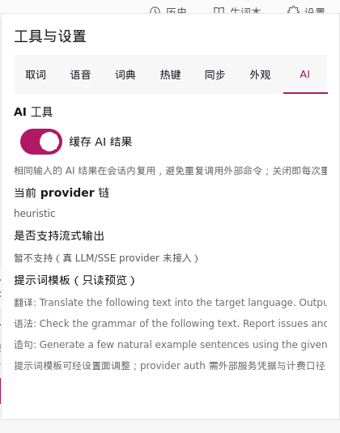

> Language: **English** | [简体中文](/config-effects)

# Config Effects

Every switch that changes app behavior, shown as a real off/on frame pair. These are not design drafts: the pairs are captured offscreen from the running app by the sandbox (`unidict_ui_sandbox`), and the same capture run is wired into CI as the `ui_sandbox_switch_effects` regression test — if a toggle's binding breaks and the flip no longer changes anything visible, the before/after frames come out identical and the test fails.

To regenerate after a UI change, build with `UNIDICT_BUILD_UI_SANDBOX=ON` and run `scripts/switch_effects_gif.sh <build-dir>` (requires ImageMagick).

## Lookup

**Clipboard lookup** — watch the clipboard and look up copied text automatically.

**Quick lookup popup** — a small floating window shows the definition instead of switching to the main window.

**Start at login** — launch automatically when you log in.

## Dictionaries

**Enable/disable a dictionary** — a disabled dictionary drops out of lookups immediately; the file stays on disk and can be re-enabled anytime. The pair below toggles the bundled CC-CEDICT (zh-en).

## Sync

**Multi-device sync** — turning sync on goes through an explicit confirm gate: the switch stays off and a hint appears; sync only starts after you review the sync scope and hit Confirm. Nothing connects to any server by default.

## Appearance

**Interface language** — switches all interface copy between Chinese and English; dictionary content always stays in its source language.

**Light / Dark** — the whole window flips between the light and dark palettes (follow-system, light, dark).

**Query normalization** — how aggressively query keys are folded before lookup (tolerant / careful / exact). The profile applies immediately: the core rebuilds its index with the selected folding.

## AI tools

**Cache AI results** — AI answers are cached locally, so the same question does not hit the API twice.

## Not captured in the sandbox

A few switches are gated by platform or by system access and cannot be driven from the offscreen sandbox:

| Switch | Tab | Why not captured |
| --- | --- | --- |
| Selection lookup (划词取词) | Lookup | Needs a live X11 selection source; hidden where unsupported |
| This device as sync host | Sync | Opens a real LAN listener (0.0.0.0) plus UDP discovery — not started from tests |
| Read focused window selection (macOS) | Lookup | macOS-only; hidden on other platforms |
