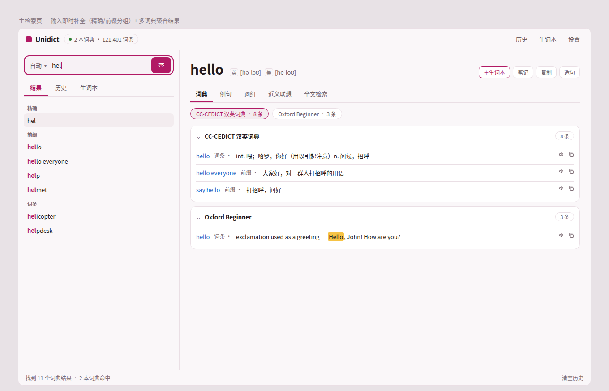
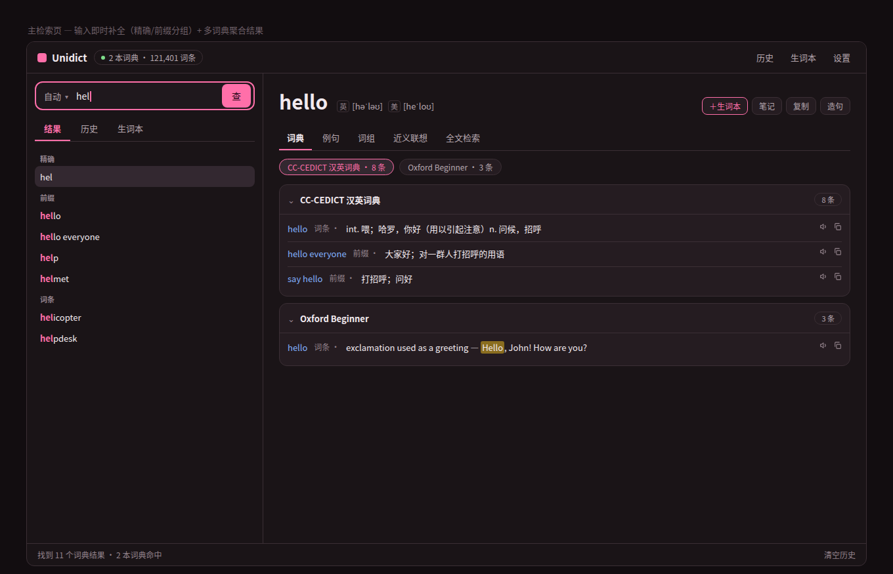
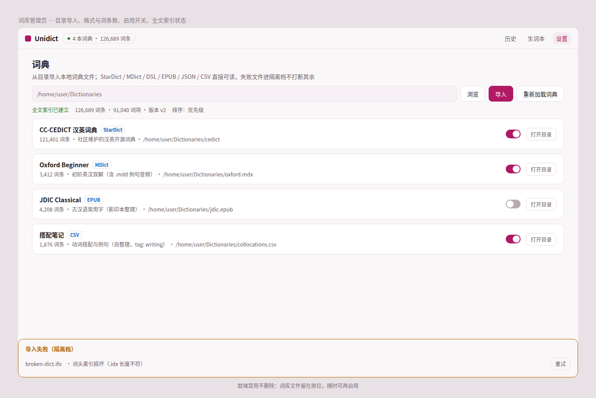
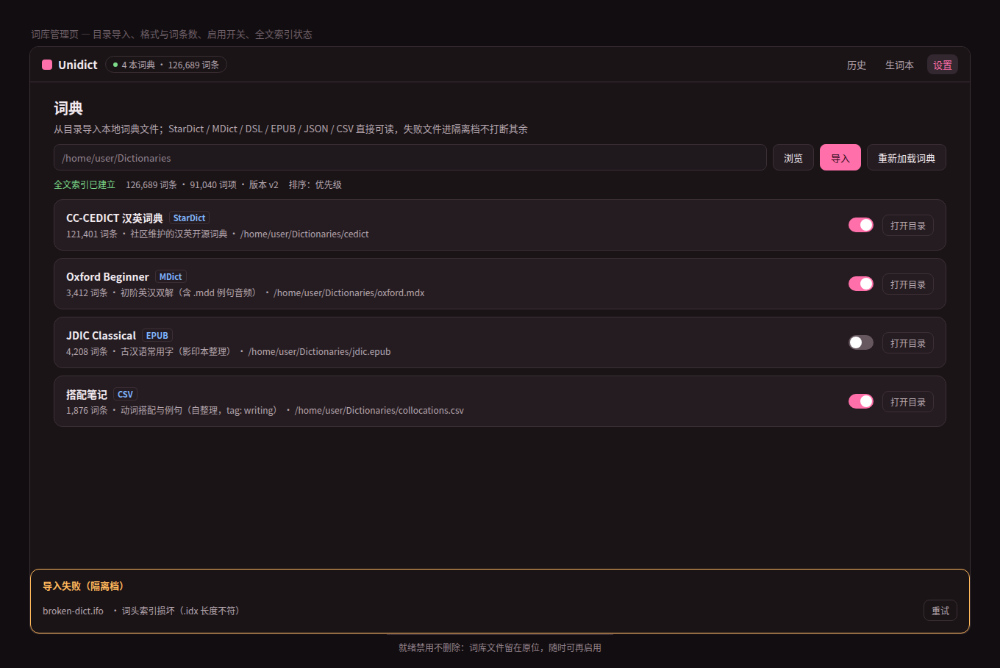
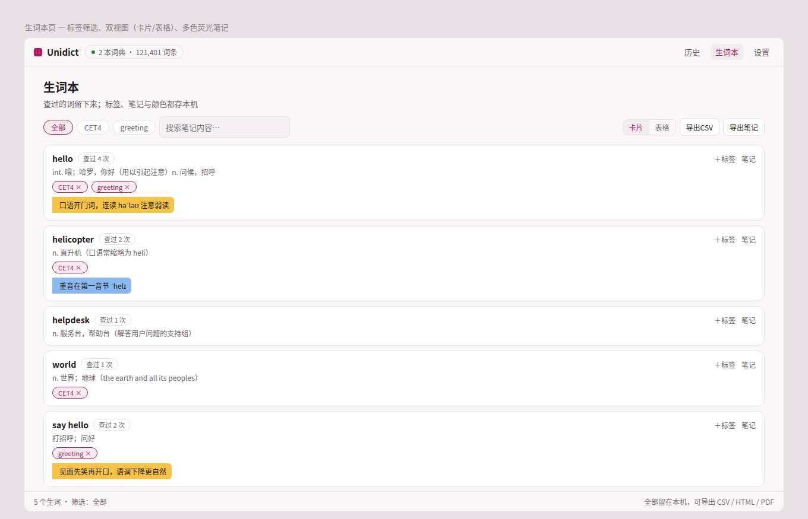
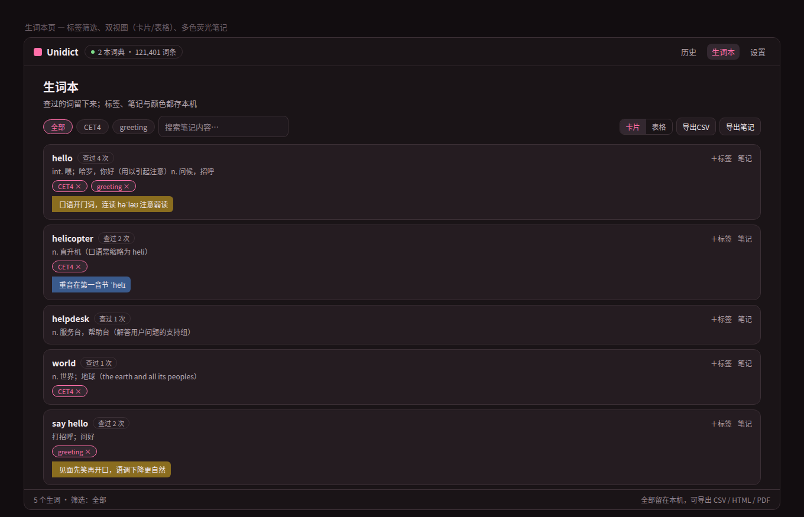
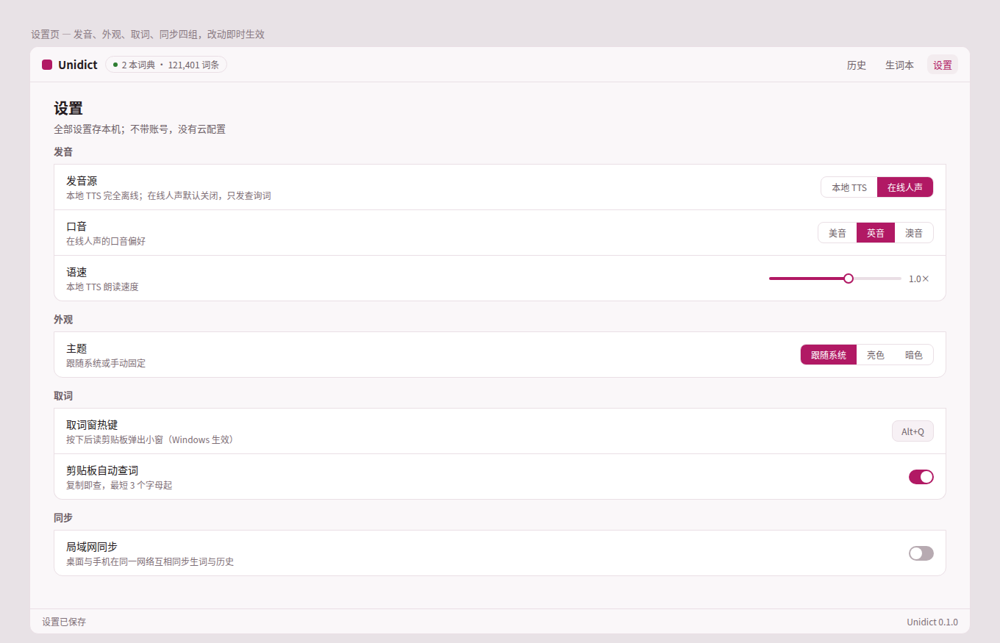
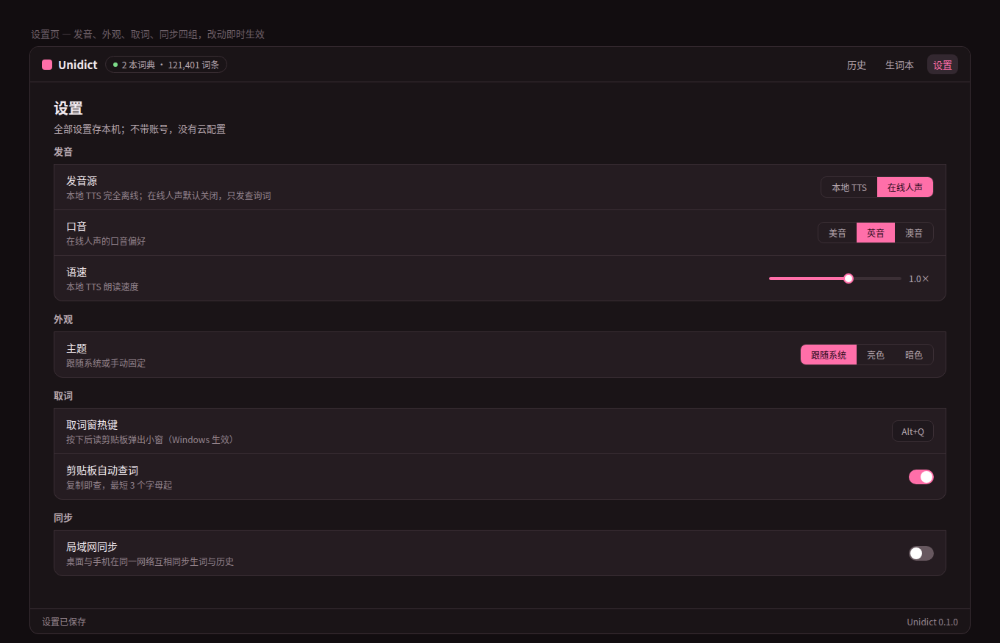

> Language: **English** | [简体中文](./prototypes.md)

# UI Prototypes

Here are prototypes of the four main desktop pages. Prototypes and implementation share one set of design tokens: brand color `#b11964` (`#ff6fa9` in the dark theme), three radius steps of 4/8/12, cards with a border, and a recessed command input bar. Before making visual changes, look at these images first; when changing tokens, update the prototype source files and re-render the images in step.

The prototypes are design drafts, not running screenshots. For screenshots of the actual current UI, see the [README](https://github.com/cuihairu/unidict) and the daily build artifacts.

## Main Lookup Page

Typing in the command bar on the left surfaces completions immediately, with suggestions grouped into three sections, "Exact / Prefix / Entry"; results on the right are grouped by dictionary into cards, and when multiple dictionaries hit, a chip row summarizing the hit dictionaries comes first.

## Dictionary Management Page

Directory import, per-dictionary entry counts and formats, enable toggles, full-text index status, failure isolation and retry — all on one page. Disabling does not delete files.

## Vocabulary Book Page

Filter by tag, card/table dual view, multi-color highlighter for notes (yellow/blue/green/pink/orange), all stored on your machine.

## Settings Page

Four groups — pronunciation, appearance, word capture, sync — with changes taking effect immediately; no account, no cloud configuration.

## Source Files and Re-rendering

- Prototype source: [`prototypes/src/prototype.html`](https://github.com/cuihairu/unidict/blob/main/docs/site/prototypes/src/prototype.html) (single file, light and dark token sets)
- Render script: [`prototypes/src/render.js`](https://github.com/cuihairu/unidict/blob/main/docs/site/prototypes/src/render.js) (Playwright, four pages × two themes for eight images total)
- Token origin: `qmlui/theme_tokens.h`
