> Language: **English** | [简体中文](./dictionary-market-survey.md)

# Dictionary/Lookup Tool Market Survey: Features, UI, and Lookup Interaction

Survey date 2026-10-08. Scope: 21 products, covering four categories: desktop clients, online dictionaries, Chinese and multilingual tools, and spaced-repetition tools. Unless noted otherwise, every screenshot in this page was captured live that day by opening the official site or web edition in a headless browser; the screenshots are embedded at the corresponding spots in the body, the originals live in `assets/` next to this page (repo path `docs/site/research/assets/`), image copyright belongs to the respective sites, and they are used for internal comparison within this project only.

Most sites could be captured. Merriam-Webster, Oxford Learner's Dictionaries, Wiktionary, and the Naver dictionary returned a verification page, a blank page, or a load timeout to the headless browser; for these products only text conclusions are given, without screenshots, with the reason spelled out in the table.

## 1. Product Inventory

**Summary of conclusions**: scanning the 21 products yields three hard conclusions. First, the mainstream shape of lookup has converged on "multiple dictionaries side by side + grouped presentation"; comprehensive clients and dictionary-container tools both do this, and the pure single-dictionary form survives only among the authoritative online sites. Second, the focus of competition is not the definitions themselves but the lookup path (the four switches: screen capture/selection lookup/popup/hotkey) and the vocabulary-book loop (import/export + review), which are exactly the two places that are also easiest to get wrong. Third, how much content can be loaded is decided by the dictionary-format compatibility surface (MDX/StarDict etc.); offline dictionaries are the reliability floor and online results are only a supplement. Item-by-item judgments are in Section 5.

| Product | Type and platform | Screenshot | Main sources |
| --- | --- | --- | --- |
| Youdao Dictionary | Commercial comprehensive client, Win/macOS/iOS/Android + web edition | Fig. 3 | [Features page](http://cidian.youdao.com/features/), [Desktop help](https://cidian.youdao.com/5.0/help/deskdict5beta/description/01.html) |
| Kingsoft PowerWord / iCIBA | Commercial client + web edition iciba.com | Fig. 4 | [iCIBA web edition](https://iciba.ijinshan.com/online/index.html), [Wikipedia](https://zh.wikipedia.org/wiki/%E9%87%91%E5%B1%B1%E8%AF%8D%E9%9C%B8) |
| Bing Dictionary | Dictionary built into a search engine, web edition | Fig. 5 | [cn.bing.com/dict](https://cn.bing.com/dict/) |
| Eudic | Commercial client, Win/macOS/Linux/iOS/Android | Fig. 10 | [Product page](https://www.eudic.net/v4/en/app/eudic), [Official docs](https://docs.eudic.net/1/shi-yong-zhi-yin/tian-jia-kuo-chong-ci-ku) |
| GoldenDict-ng | Open-source dictionary aggregator, Win/macOS/Linux | Fig. 8 | [Official docs](https://xiaoyifang.github.io/goldendict-ng/), [LinuxLinks review](https://www.linuxlinks.com/goldendict-ng-advanced-dictionary-lookup-program/) |
| MDict | Commercial dictionary reader, Win/iOS/Android | Fig. 13 | [Official site](https://www.mdict.cn/) |
| StarDict / sdcv | StarDict, including the command-line sdcv | None (project has entered maintenance mode) | [StarDict TODO page](https://stardict-4.sourceforge.net/todo.php), [Open-source offline dictionaries roundup](https://wiloon.com/open-source-dictionaries/) |
| Anki | Open-source spaced-repetition cards, desktop/Android/iOS/web | Fig. 9 | [Official site](https://apps.ankiweb.net/) |
| Merriam-Webster | Online American-English dictionary | None (headless browser blocked by Cloudflare) | [merriam-webster.com](https://www.merriam-webster.com/) |
| Cambridge Dictionary | Online English-Chinese/English-English dictionary | Fig. 11 | [dictionary.cambridge.org](https://dictionary.cambridge.org/) |
| Oxford Learner's Dictionaries | Online learner's dictionary | None (returned a blank page) | [oxfordlearnersdictionaries.com](https://www.oxfordlearnersdictionaries.com/) |
| Longman LDOCE | Online English-English dictionary with frequency and topic marks | Fig. 12 | [ldoceonline.com](https://www.ldoceonline.com/dictionary/proposal) |
| Linguee | Bilingual parallel-example dictionary | Fig. 7 | [linguee.com](https://www.linguee.com/), [Google Play listing](https://play.google.com/store/apps/details?hl=en_US&id=com.linguee.linguee) |
| DeepL | Split-pane translation with a dictionary section attached | Fig. 6 | [deepl.com/translator](https://www.deepl.com/translator) |
| Wiktionary | Open-source multilingual dictionary | None (page load timed out) | [en.wiktionary.org](https://en.wiktionary.org/) |
| zdic | Online Chinese character/word dictionary + classical text references | Fig. 14 | [zdic.net](https://zdic.net/), [Site walkthrough](https://stack.liuhuo.org/zh-hant/discover/zdic) |
| Baidu Hanyu | Online Chinese character/word dictionary | Fig. 15 | [hanyu.baidu.com](https://hanyu.baidu.com/) |
| Contemporary Chinese Dictionary app | Commercial Press official app, iOS/Android | Fig. 16 | [App Store](https://apps.apple.com/cn/app/id1330896529), [Pricing controversy report](https://www.sohu.com/a/343817302_372465) |
| Pleco | Chinese-learning dictionary app, iOS/Android | Fig. 1 | [Official site](https://www.pleco.com/), [App Store listing](https://apps.apple.com/us/app/pleco-chinese-dictionary/id341922306) |
| Jisho | Online Japanese-English dictionary | Fig. 2 | [jisho.org](https://jisho.org/), [FAQ](https://jisho.org/faq) |
| Naver Dictionary | Online Korean-English/Korean-Chinese dictionary | None (page rendered blank) | [dict.naver.com](https://dict.naver.com/), [University library usage guide](https://guides.libraries.emory.edu/c.php?g=50404&p=7228209) |

## 2. Six Interaction Threads Running Through the Products

### 1. Input: how many entry points beyond spelling

English lookup is basically just keyboard spelling plus autocomplete, so the input boxes of Youdao, Bing, and Linguee all look alike: one box, one dropdown suggestion list, automatic language-direction detection. The difference lies in error correction and tolerance. Linguee, for example, returns results after just the first few letters are typed and tolerates errors automatically; GoldenDict-ng uses Hunspell for lemmatization to skip over tense and plural forms ([feature list](https://xiaoyifang.github.io/goldendict-ng/)), and it also implements Unicode folding, so typing `Grussen` hits `grüßen`.

With Chinese and Japanese, input methods immediately split into a whole row of entry points. The Contemporary Chinese Dictionary app has nine retrieval dimensions: single character, word, pinyin, radical, stroke count, four-corner code, handwriting, voice, and camera ([App Store listing](https://apps.apple.com/cn/app/id1330896529)); zdic hangs a radical index, total stroke count, pinyin, and bopomofo on the same page, plus character decomposition, Wubi, Cangjie, four-corner code, Unicode, and other character-lookup methods ([site walkthrough](https://stack.liuhuo.org/zh-hant/discover/zdic)); Pleco's entry points are five: characters, pinyin (tones optional), English, handwriting, and OCR, with pen and camera buttons permanently below the search box ([App Store listing](https://apps.apple.com/us/app/pleco-chinese-dictionary/id341922306)).

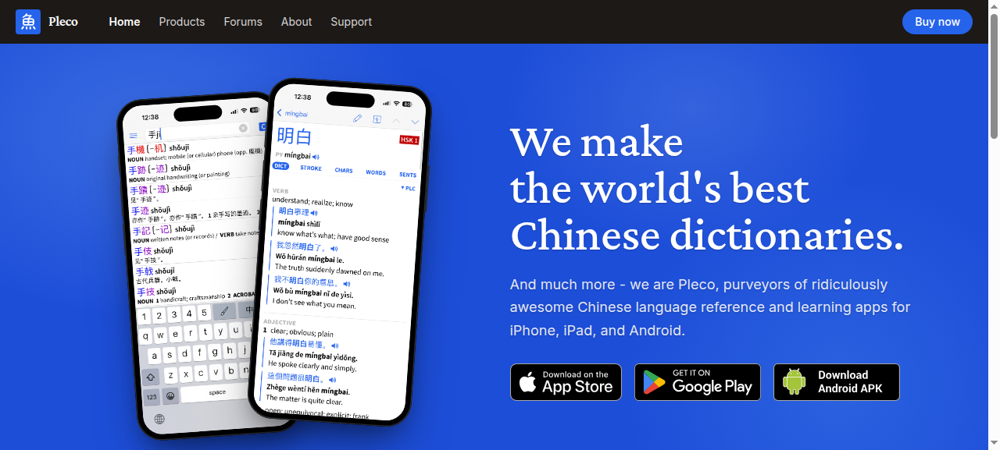

Fig. 1 The Pleco official site hero: the phone on the left shows an entry page, the right side shows the handwriting input keyboard.

Jisho pushes this further: below the search box sit fixed Draw, Radicals, and Voice buttons; English, romaji, kana, and kanji can all be searched directly, and pasting a whole sentence gets it automatically segmented and displayed in parts.

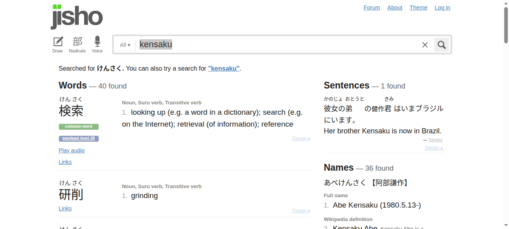

Fig. 2 Jisho search results: Draw, Radicals, and Voice sit permanently below the search box, and on the right are the sentences and names columns.

### 2. Triggering: screen capture, selection lookup, popup, hotkey

These four things are often lumped together, but they are really four separate switches. The Youdao desktop edition turns them into a switch matrix: screen capture and selection translation each have an independent switch, both work in browsers, images, and PDF, plus there is OCR lookup and smart phrase lookup ([features page](http://cidian.youdao.com/features/)). Eudic takes the "copy-to-lookup" route: copy text in another program, open Eudic, and it looks the word up automatically; after a screenshot or a photo it also offers to translate the image, which the official docs call LightPeek cross-program lookup ([software intro](https://dict.eudic.net/areas/gitbook/1.html)); it also provides a URL scheme such as `eudic://dict/word` for external invocation ([changelog](https://www.eudic.net/v4/en/app/history?appkey=eusoft_eudic_en)).

GoldenDict-ng's lookup is called Scan Popup: select text and a popup appears, plus a global hotkey summons the lookup window ([LinuxLinks review](https://www.linuxlinks.com/goldendict-ng-advanced-dictionary-lookup-program/)).

In real use this thread is the shakiest. A user comparing Youdao and Eudic mentioned that on macOS, screen capture mislocates in some programs and occasionally stops responding; with Youdao they "never once got it to work". Selection search is affected by shortcut settings and not very efficient ([comparison discussion](https://github.com/kaiye/kaiye.github.com/issues/5)). Another comparison noted that Eudic's built-in selection translation is mediocre, and even after adding a third-party translation engine, selection lookup still goes through the built-in channel and cannot be swapped out ([V2EX discussion](https://v2ex.com/t/821603)). These two are the same class of problem: the lookup path crosses processes and permissions, so no matter how complete it is, stability is hard to guarantee; as a product decision it is better to give users explicit switches and a manual fallback.

### 3. Result presentation: single-column flow, split panes, dictionaries side by side

Three mainstream layouts.

The single-column vertical flow is the default shape of web dictionaries. Youdao puts "definitions / authoritative dictionaries / usage / example sentences" outline anchors on the left, switches the body between "web definitions / professional definitions / English-English definitions" tabs, and hangs a phrases column on the right. PowerWord has three tabs ("concise / AI definitions / AI word analysis") with a jump bar for definitions, inflections, examples, and English-English definitions on the right. Bing Dictionary turns Advanced E-C, C-E, E-E, and Web Definition into bottom tabs, with collocations and synonyms as separate blocks.

Fig. 3 The Youdao Dictionary web edition entry for proposal: the left holds the definitions/authoritative-dictionaries/usage/examples outline, the body is tabbed into web definitions, professional definitions, and English-English definitions, and phrases hang on the right.

Fig. 4 The iCIBA entry page: the three tabs concise/AI definitions/AI word analysis, with the right column holding jumps to definitions, inflections, examples, and English-English definitions.

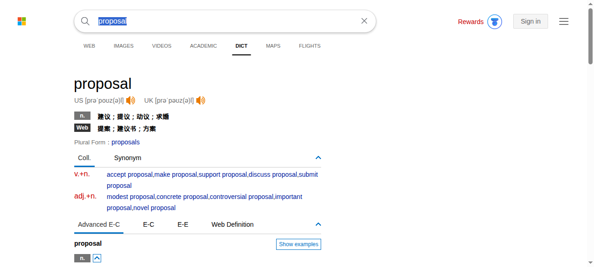

Fig. 5 The Bing Dictionary DICT tab page: the bottom holds the four switches Advanced E-C, C-E, E-E, Web Definition, with collocations and synonyms as separate blocks.

Left-right split panes are the default shape of translation products. DeepL has input on the left and the translation on the right, with a Dictionary block attached at the lower left; Linguee has now been folded into DeepL's navigation, where the Translator/Write/Dictionary tabs sit at the top, and its main area shows the entry plus common translations, rarer translations, and example-sentence groups.

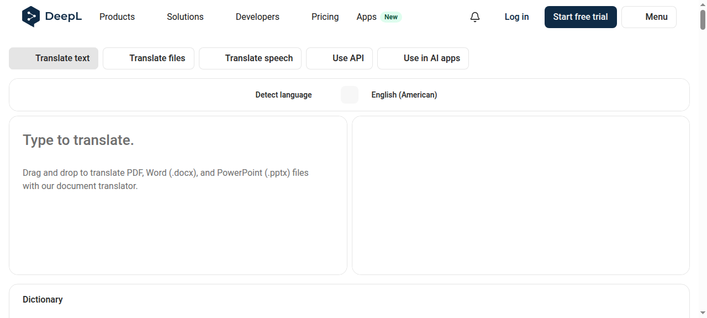

Fig. 6 The DeepL translation UI: left-right split panes, with a Dictionary section attached at the lower left.

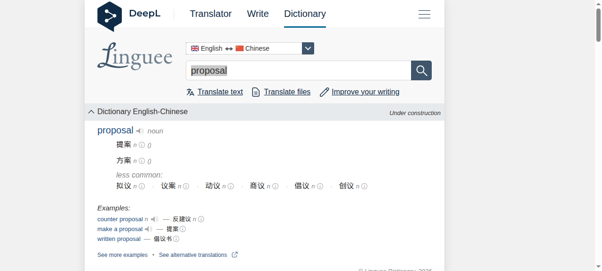

Fig. 7 The Linguee entry page, now under DeepL navigation: the main area holds common translations, rarer translations, and example-sentence groups.

Multiple dictionaries side by side is the signature of the "dictionary container" class. GoldenDict-ng puts the results of several dictionaries on one page, supports treating websites, external programs, and audio collections as dictionary sources, and uses Xapian for cross-dictionary full-text search ([official docs](https://xiaoyifang.github.io/goldendict-ng/)). Eudic's full-text search requires first enabling indexing dictionary by dictionary in "dictionary library management"; only once indexing finishes do results appear on the explanation page ([official docs](https://docs.eudic.net/1/shi-yong-zhi-yin/dan-ci-cha-xun/quan-wen-sou-suo-1)). This per-dictionary indexing design shows that the cost of full-text search is borne by the user; as a product decision, either build the index for them by default or make the waiting time explicit.

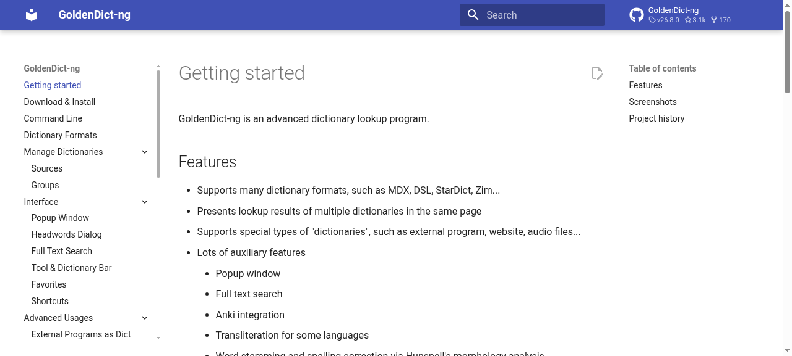

Fig. 8 The GoldenDict-ng official docs home page: the left navigation lists interface sections such as popup, word list, and full-text search.

### 4. Vocabulary books: formats, sync, and review curves

The three vendors' import formats do not line up, which is the main friction in actual migration. The Youdao vocabulary book imports .bin/.xml/.txt, exports .bin/.xml/.txt/.doc, and syncs with the server in real time ([Zhihu answer](https://www.zhihu.com/question/19627547/answer/76589623)); Eudic imports PowerWord's .txt, Youdao's .xml, and plain txt, and also does cloud sync (same source). Neither side accepts the other's primary format, so switching tools can only go through txt as the relay.

Review features have essentially become standard equipment. Youdao builds the Ebbinghaus forgetting curve into its wordbook and supports importing CET-4/CET-6 word lists to review directly ([features page](http://cidian.youdao.com/features/)); Pleco's flashcard system supports SRS, fill-in-the-blank, and tone training, and turns any entry into a card with one tap ([App Store listing](https://apps.apple.com/us/app/pleco-chinese-dictionary/id341922306)); Anki simply excludes lookup from its positioning: it is a pure card engine, extended through AnkiWeb and a plugin ecosystem ([official site](https://apps.ankiweb.net/)). GoldenDict-ng also ships an Anki integration where entries can become cards directly ([official docs](https://xiaoyifang.github.io/goldendict-ng/)).

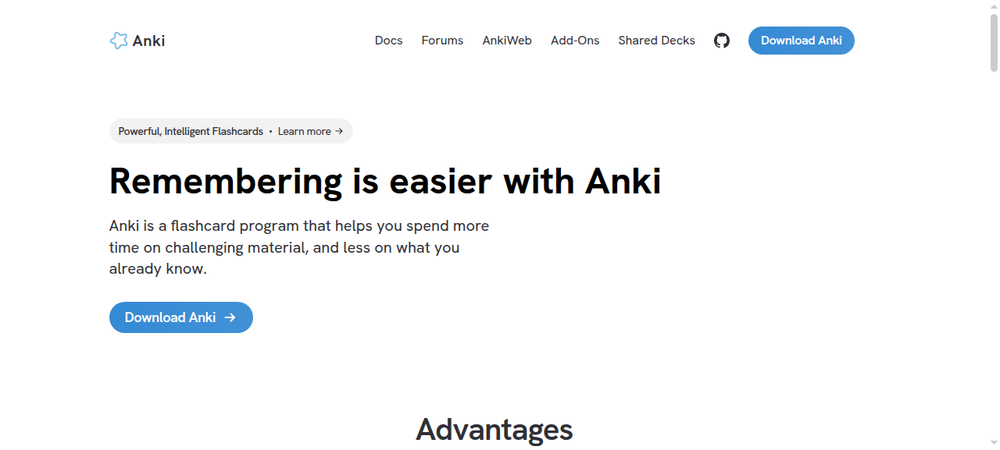

Fig. 9 The Anki official site home page.

### 5. The division of labor between offline and online

Eudic makes offline a selling point: 300,000 built-in common English-Chinese entries, 400,000 professional entries, and 500,000 example sentences, all lookup-able offline ([product page](http://www.eudic.net/v4/en/app/eudic)). Youdao is the opposite: web definitions, encyclopedia, and examples mostly depend on being online, and the free edition carries ads that can be turned off manually ([desktop help](https://cidian.youdao.com/5.0/help/deskdict5beta/description/01.html)). This split directly shapes the UI: an offline-first product should put dictionary status (downloaded/not downloaded) into the main interface, while an online-first product has to handle timeouts, empty results, and ad slots.

Fig. 10 The Eudic official product page: the right side is a mock-up of the mobile interface.

Authoritative online dictionaries follow a different logic. Cambridge, Longman, and Oxford keep their content on servers; the interactions are conservative but the typesetting is stable, and frequency marks, topic tags, and example audio are all present. Longman, for instance, marks entries with S3/W3 frequency and a Family topic. The cost is that content is gated by paywalls and anti-scraping; in this survey Merriam-Webster and Oxford could not be captured.

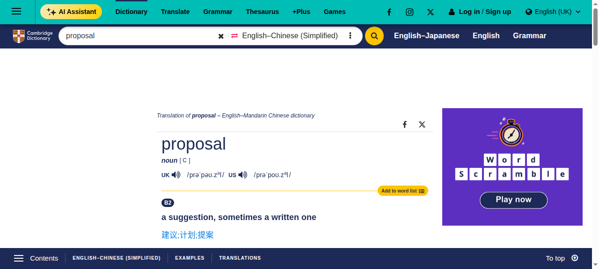

Fig. 11 A Cambridge Dictionary English-Chinese (simplified) entry page, with pronunciation, definitions, examples, and translation tabs.

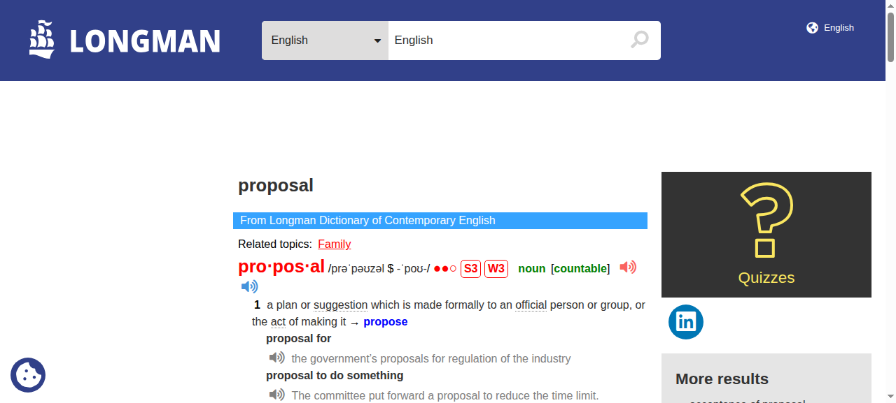

Fig. 12 A Longman LDOCE entry page: S3/W3 frequency marks, topic tags, and example audio.

### 6. The dictionary-format ecosystem

Differences between desktop products land mostly here. Five formats: MDX/MDD (MDict), DSL (Lingoes), BGL (Babylon), StarDict, and ZIM (Kiwix). All are portable across multiple clients: GoldenDict-ng supports all of them ([official docs](https://xiaoyifang.github.io/goldendict-ng/)); Eudic supports MDict, Lingoes, and Babylon and ships a dictionary editor ([official docs](https://docs.eudic.net/1/shi-yong-zhi-yin/tian-jia-kuo-chong-ci-ku)); MDict is the native client of MDX itself. StarDict's .ifo/.idx/.dict three-file format is still being converted to this day, and even the command-line tool sdcv is still maintained ([roundup table](https://wiloon.com/open-source-dictionaries/)), though development of StarDict proper has entered a maintenance-only stage ([TODO page](https://stardict-4.sourceforge.net/todo.php)).

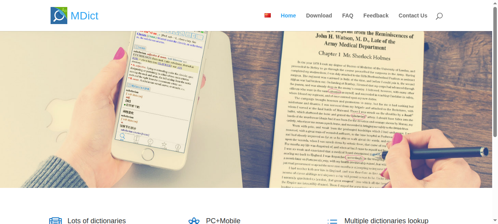

Fig. 13 The MDict official site hero: a product shot contrasting the mobile entry page with a printed book.

On the open-data side, datasets like ECDICT convert between CSV, SQLite, StarDict, and MDX, and tag CET-4/6, IELTS, and TOEFL syllabuses, Collins star ratings, Oxford 3000, and BNC/COCA frequency ([repo](https://github.com/skywind3000/ECDICT)). When building a client, the dictionary-format compatibility surface decides how much content fits more than interface styling does.

## 3. Chinese and Multilingual

Chinese and multilingual support is not a translated copy of English lookup: the retrieval dimensions, the objects being looked up, and the interface density all differ, so it deserves its own section.

**An order-of-magnitude gap in retrieval dimensions.** An English entry has only a headword; a Chinese character carries a pile of attributes (pinyin, bopomofo, radical, stroke count, structure, Unicode, Wubi, Cangjie, four-corner code), and zdic aligns all of them line by line in the entry header. Baidu Hanyu layers "basic definition / detailed explanation / dictionary definition", with synonyms and antonyms, collocations, and example sentences right behind, and a trending characters-and-words column reserved on the right. With the same single search box, a Chinese product's result page carries two to three more information blocks than an English product's.

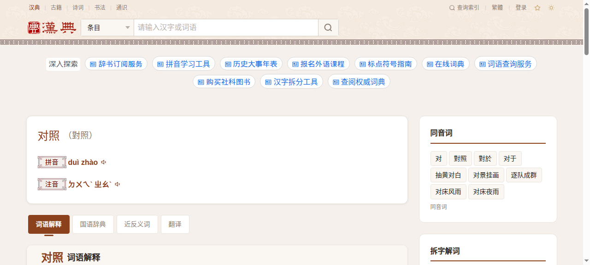

Fig. 14 The zdic entry for "duizhao" ("to compare"): the entry header aligns pinyin, bopomofo, radical, strokes, and Unicode, and the body is split into four tabs: word explanations, the Mandarin dictionary (Guoyu Cidian), synonyms/antonyms, and translations.

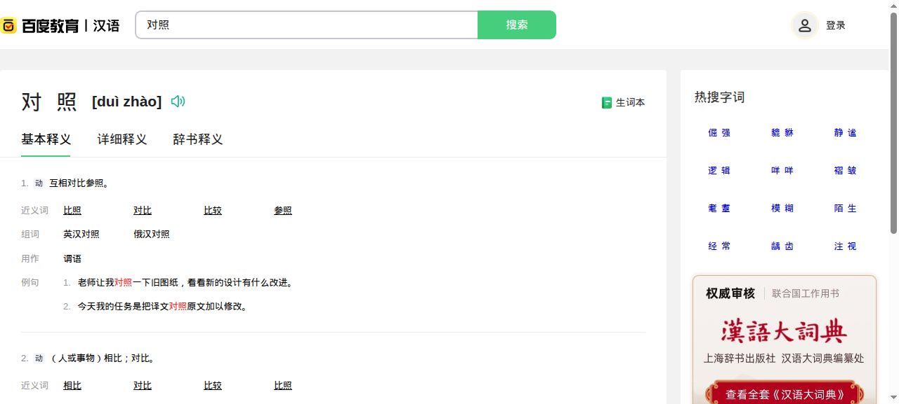

Fig. 15 The Baidu Hanyu entry for "duizhao": basic definition/detailed explanation/dictionary definition in layers, with a trending characters-and-words column on the right.

**The print edition's retrieval paths were moved into the app wholesale.** The Contemporary Chinese Dictionary app keeps the original browse-through mode, layers keyword search on top, and turns every traditional character-lookup method (radical, strokes, four-corner code, handwriting) into a digital entry point, while adding voice and camera as two new entry points ([App Store listing](https://apps.apple.com/cn/app/id1330896529)). This "two modes coexisting" layout is nearly absent from English products, because English has no radicals or stroke order. The App Store page shows the app rated 4.2 with 5,952 ratings; its 98 CNY price caused controversy at the time ([report](https://www.sohu.com/a/343817302_372465)), which shows there is a clear ceiling on what Chinese users will pay for a digital edition of an authoritative dictionary.

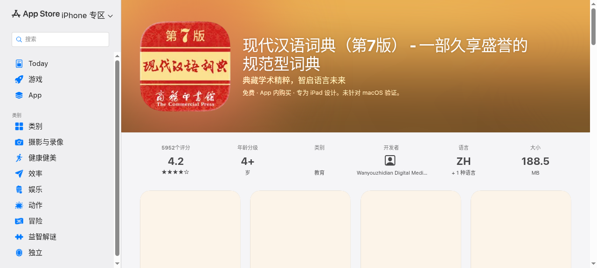

Fig. 16 The Contemporary Chinese Dictionary app page on the App Store, rated 4.2 with 5,952 ratings.

**The "bidirectional" in Chinese-English bidirectional is an input-direction problem.** The Youdao desktop edition supports mutual translation among five languages (Chinese, English, French, Japanese, and Korean) and applies automatic language detection to screen capture, selection lookup, and translation ([desktop help](https://cidian.youdao.com/5.0/help/deskdict5beta/description/01.html)); Eudic is likewise bidirectional English-Chinese/Chinese-English, with built-in WordNet English-English definitions and synonym/antonym databases ([product page](http://www.eudic.net/v4/en/app/eudic)). Automatic detection fails more annoyingly in Chinese contexts: type an English phrase and get it explained as Chinese, or the reverse, so both Youdao and Bing put an explicit Chinese-English/English-Chinese toggle on the search box.

The objects being looked up differ too. English lookup must handle inflection: `proposals` and `proposed` both have to jump back to `proposal`; GoldenDict-ng uses Hunspell for morphological analysis, and Eudic also builds in inflection handling ([LinuxLinks review](https://www.linuxlinks.com/goldendict-ng-advanced-dictionary-lookup-program/)). Chinese has no inflection, so the hard part becomes segmentation boundaries: a four-character idiom, a proper noun, or a sentence mixing classical and vernacular style; cut it wrong and nothing is found. Chinese lookup also often comes with OCR scenarios: menus, street signs, and scanned documents all need to be photograph-then-lookup. Pleco's live OCR is a paid one-time purchase that overlays definitions directly on the viewfinder after shooting ([review](https://hsklord.com/blog/pleco-review)).

Input habits differ per language, too. Japanese mixes kana, romaji, and kanji with no spaces mid-sentence; Jisho's approach is to search the whole sentence, auto-segment the results, then filter with tags like `#common`, `#name`, and JLPT, with handwriting and radicals as two kanji fallbacks ([Tofugu review](https://www.tofugu.com/japanese-learning-resources-database/jisho-org/), [FAQ](https://jisho.org/faq)). On the Korean side, the Naver dictionary supports handwriting, voice, and image as three input methods ([usage guide](https://guides.libraries.emory.edu/c.php?g=50404&p=7228209)). Traditional/simplified conversion and bopomofo are also mandatory questions for Chinese products: Pleco supports traditional and simplified across all modules, offers pinyin or bopomofo for pronunciation, and some of its dictionaries include Cantonese ([Google Play listing](https://play.google.com/store/apps/details/Pleco_Chinese_Dictionary?id=com.pleco.chinesesystem&hl=zh_CN)); zdic provides a simplified/traditional toggle and a dark mode ([site walkthrough](https://stack.liuhuo.org/zh-hant/discover/zdic)).

The conclusion of this section: any lookup tool that claims to be "multilingual" must, in its very first version, decide whether its retrieval-dimension data structures can hold fields like radical, stroke count, bopomofo, and kana readings, and whether OCR and handwriting are built in or left to plugins. Wait until the English edition is done and then bolt on Chinese, and the result page's information architecture has to be redone almost from scratch.

## 4. The Trade-offs of Each Product Class

Comprehensive clients of the Youdao, Kingsoft, and Bing tier have the fullest features and the fastest online access, and adopted AI definitions early; the price is ads, memberships, and feature stacking. Youdao layers web definitions, professional definitions, and English-English definitions, and documents manual ad dismissal in its help; Kingsoft puts the "concise / AI definitions / AI word analysis" tabs on the first screen. Their common trait is high first-screen information density, cramming content in through tabs and a right-hand column.

GoldenDict-ng, Eudic, and MDict are dictionary containers: the content ceiling is set by the dictionaries the user imports, the interface serves "several side by side + full-text search", and the configuration cost is high too. Eudic's full-text search needs per-dictionary indexing enabled; GoldenDict-ng expects you to prepare MDX/DSL/StarDict/ZIM files yourself. They lack cloud capabilities like web definitions, but offline support and format compatibility are hard advantages.

Authoritative online dictionaries of the Cambridge, Longman, Oxford, and Merriam-Webster kind have the highest definition and example quality, restrained typesetting, and mature frequency and topic annotation systems; anti-scraping, paywalls, and ad slots are the usage friction; in a headless-browser environment, two of them could not be captured this time.

Linguee and DeepL take the corpus-parallel route; the selling point is human-translated example sentences rather than single definitions. Linguee stresses that its entries come from edited dictionaries by more than 400 lexicographers and translation parallels at the billion scale ([Google Play listing](https://play.google.com/store/apps/details?hl=en_US&id=com.linguee.linguee)); DeepL sells translation quality and document translation, with the dictionary section as an auxiliary panel. Their input box is the main interface, and the lookup action is compressed into a single screen.

Anki, Pleco flashcards, and the Youdao wordbook are the learning type: lookup is only the entrance, review is the point. The difference is openness: Anki is fully open, extended through plugins and shared decks; Pleco's handwriting, OCR, stroke-order animations, and some dictionaries are paid add-ons; Youdao ties review to its own account and word lists.

## 5. Applicability Analysis: Item-by-Item Judgments and Landing Points

Rating rubric: **adopt** = an endorsed practice, already landed in unidict or listed in the todo to push forward; **reference** = the idea is inspiring, take only part of it or the landing point is pending; **not applicable** = conflicts with the product positioning, explicitly not doing it.

| Finding | Judgment | Landing point | Notes |
| --- | --- | --- | --- |
| Multiple dictionaries side by side + grouped tabs (GoldenDict-ng/Eudic) | Adopt (landed) | Lookup interaction / UI | Grouped aggregate query (three-tier fallback + in-group headword dedup) already delivered, same shape on desktop and Android; dictionaries can be enabled and prioritized per library |
| The four lookup switches (screen capture/selection/popup/hotkey) controlled separately | Adopt | Lookup interaction (todo) | Floating lookup window + global hotkey (Windows) already exist; selection lookup is a platform placeholder; survey lesson = failures must be perceivable and offer a manual fallback, consistent with this direction |
| Lemmatization and input tolerance (Hunspell/Unicode folding) | Reference (partially landed) | Lookup interaction | Lemmatization (lemma) and fuzzy suggestions already exist; Unicode folding not done, low priority |
| Field slots for Chinese retrieval dimensions (pinyin/bopomofo/radical/strokes/four-corner) | Adopt | Lookup interaction (todo) | The heaviest lesson of this survey: the multilingual entry data structure must reserve these fields in the first version; the current entry structure does not carry them, to be considered together with the formal dictionary-library surface and new format onboarding |
| Handwriting/OCR/camera lookup built in | Not applicable (first version) | Lookup interaction | Desktop has no camera scenario; Android has a camera but the cost of clearing the feature bar is high; Pleco's paid-add-on approach is worth referencing |
| Print browse mode coexisting (Contemporary Chinese Dictionary app) | Not applicable (first version) | UI | Does not fit the restraint policy; not doing it |
| High-density result-page layout (outline anchors/tab switching/right column) | Reference | UI | The Youdao/Kingsoft shapes have high information density but feel heavily stacked; we keep the single-card grouped flow for now and are not bringing in dense layouts |
| Full-text indexing progress/duration visible | Adopt | Lookup interaction / UI (todo) | The desktop full-text index management surface already exists; progress and duration visibility need to be checked and filled in; Eudic's per-dictionary indexing is the counterexample; this must not happen silently |
| Vocabulary book import/export in common formats | Adopt | Vocabulary book (todo) | CSV export exists, import is missing; at least support plain txt/CSV as the relay format; Youdao/Eudic not accepting each other's formats is a ready-made counterexample |
| Review curves/SRS flashcards | Not applicable (marketing-feature boundary) | Vocabulary book | Review already delivered on a simple rubric: four-skill tier rings, fully-stable entries leave the list; no forgetting curves/levels/incentives; Anki's positioning is a pure card engine, not something to copy |
| Offline-first + dictionary status in the main interface | Adopt (already aligned) | UI / global | local-first is a hard constraint; online pronunciation/AI are off by default and online is only a supplement; dictionary-status presentation will be finalized with the formal dictionary-library surface |
| Dictionary-format compatibility surface (MDX/DSL/StarDict/ZIM) | Reference | Dictionary library (P-6) | StarDict/MDX/epub/JSON already supported; DSL/ZIM not on the near horizon; ECDICT's frequency/syllabus tags can serve as headword metadata reference |
| AI definition/AI word-analysis as separate tabs | Reference | Lookup interaction | The AI provider is already abstracted with a heuristic fallback; the AI surface stays restrained, no marketing-style tabs |
| URL scheme/system-share external invocation (eudic://) | Reference | Lookup interaction (todo, low priority) | Neither end has external invocation wired up; if done, Android goes through system share and desktop references the URL scheme shape |
| Ads/membership/account ecosystem | Not applicable | Positioning | Zero accounts and no ads are settled policy; Youdao's free-edition ads + review tied to its own account is the counterexample; sync keys never leave the device |
| Frequency/topic annotation (S3/W3/topic tags) | Reference | UI / entry card | Long-term, see whether the entry card surfaces the dictionary's own frequency marks; not proactively building a separate system |
