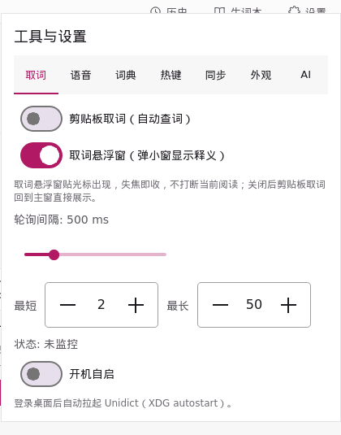
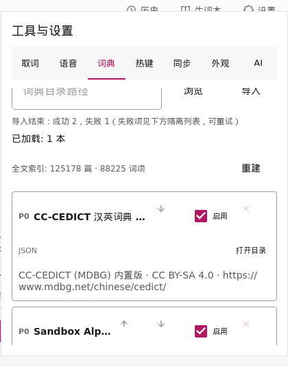
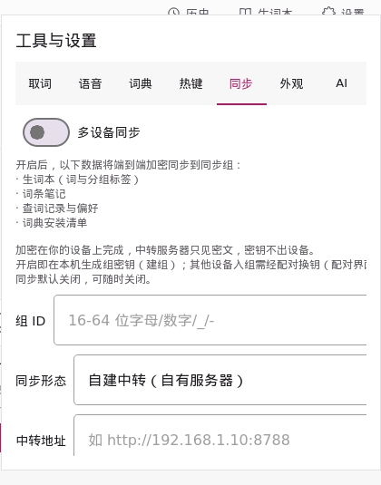
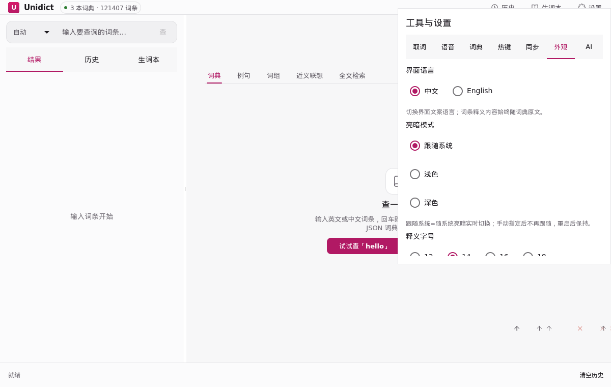
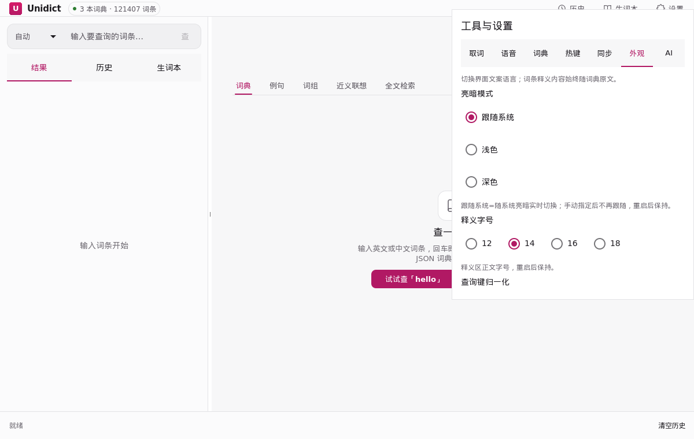
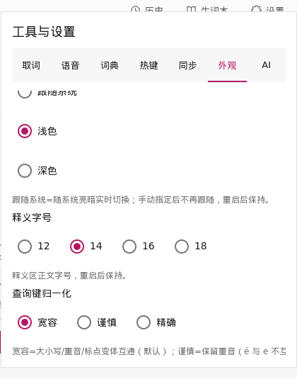
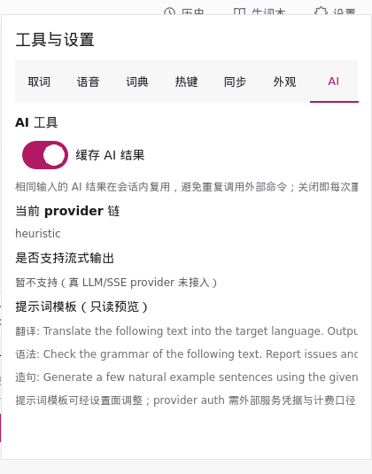

> 语言: **简体中文** | [English](/config-effects)

# 配置效果

每个改变应用行为的开关，都配一组真实的「关/开」前后帧。这不是设计稿：帧对由离屏沙盒（`unidict_ui_sandbox`）从运行中的应用逐开关截取，同一趟截取也接进 CI 作为 `ui_sandbox_switch_effects` 回归测试——开关绑定一旦断链（翻面后界面毫无变化），前后帧完全相同，测试即红。

界面改动后重新出图：以 `UNIDICT_BUILD_UI_SANDBOX=ON` 构建，跑 `scripts/switch_effects_gif.sh <build 目录>`（依赖 ImageMagick）。

## 取词

**剪贴板取词** — 监视剪贴板，复制即自动查词。

**取词悬浮窗** — 弹小窗显示释义，不切主窗。

**开机自启** — 登录后自动启动。

## 词典

**启用/停用词典** — 停用即刻退出查询；文件保留在原地，随时可再启用。下图开关的是随包的 CC-CEDICT（中英）。

## 同步

**多设备同步** — 开启走显式确认门：开关不翻面、先出提示，确认同步范围并点「确认开启」后才开始。默认不连接任何服务器。

## 外观

**界面语言** — 界面文案中英一键切换；词条释义内容始终随词典原文。

**亮暗模式** — 整窗在浅色/深色两套配色间翻转（跟随系统、浅色、深色三档）。

**查询键归一化** — 查询键在检索前的折叠力度（宽容 / 谨慎 / 精确）。换档即时生效：core 按所选折叠方式重灌索引。

## AI 工具

**缓存 AI 结果** — AI 回答本地缓存，同一问题不再重复请求 API。

## 沙盒未截取

部分开关受平台或系统权限限制，离屏沙盒驱动不了：

| 开关 | 所在页 | 未截取原因 |
| --- | --- | --- |
| 划词取词 | 取词 | 需要真实 X11 选区来源，不支持的平台隐藏 |
| 本机作为同步宿主 | 同步 | 会开真实局域网监听（0.0.0.0）+ UDP 发现，测试不启动 |
| 读焦点窗选区（macOS） | 取词 | 仅 macOS 可见，其他平台隐藏 |
